# Báo cáo đầy đủ: Dự báo diện tích ngập ở Đồng bằng sông Cửu Long

> **Đọc file này là đủ để nắm toàn bộ đồ án**: bài toán, dữ liệu, luật chơi, 4 mô hình, cách đo, mọi bảng,
> mọi hình và ý nghĩa của từng con số. Không cần biết trước thống kê hay máy học: mọi thuật ngữ được giải thích
> ở [mục 3](#3-từ-điển-nhỏ-đọc-trước-khi-đọc-số).
>
> Mọi số trong báo cáo được lấy từ file trong `results/` (đường dẫn ghi kèm). Nếu chạy lại code mà số khác,
> số trong file là đúng.

---

## Mục lục

0. [Đọc trong 2 phút](#0-đọc-trong-2-phút)
1. [Bài toán](#1-bài-toán)
2. [Dữ liệu](#2-dữ-liệu)
3. [Từ điển nhỏ (đọc trước khi đọc số)](#3-từ-điển-nhỏ-đọc-trước-khi-đọc-số)
4. [Luật chơi chung: thi thế nào cho công bằng](#4-luật-chơi-chung-thi-thế-nào-cho-công-bằng)
5. [Chấm điểm và kiểm định](#5-chấm-điểm-và-kiểm-định)
6. [Các mô hình](#6-các-mô-hình)
   - 6.1 [Hai mốc ngây thơ: Persistence và Clim5](#61-hai-mốc-ngây-thơ-persistence-và-clim5)
   - 6.2 [AnomAR1 – mốc chính](#62-anomar1--mốc-chính)
   - 6.3 [GAM](#63-gam--mô-hình-cộng-tổng-quát)
   - 6.4 [LightGBM](#64-lightgbm--cây-tăng-cường)
   - 6.5 [Chronos-2](#65-chronos-2--mô-hình-nền-zero-shot)
7. [So sánh chung 4 mô hình](#7-so-sánh-chung-4-mô-hình)
8. [Theo điều kiện: khi nào mô hình nào khá hơn](#8-theo-điều-kiện-khi-nào-mô-hình-nào-khá-hơn)
9. [Kết luận, cách nói an toàn, hạn chế](#9-kết-luận-cách-nói-an-toàn-hạn-chế)
10. [Code: cấu trúc repo và cách chạy lại](#10-code-cấu-trúc-repo-và-cách-chạy-lại)
11. [Danh mục mọi bảng và hình](#11-danh-mục-mọi-bảng-và-hình)
12. [Câu hỏi vấn đáp thường gặp](#12-câu-hỏi-vấn-đáp-thường-gặp)

---

## 0. Đọc trong 2 phút

**Câu hỏi:** Ở Đồng bằng sông Cửu Long (ĐBSCL), mỗi năm có một mùa lũ (khoảng tháng 6 đến tháng 12).
Nhìn diện tích đang ngập hôm nay, ta có đoán được diện tích ngập sau **8, 16, 32 ngày** không? Và các mô hình
"hiện đại" có đoán giỏi hơn một công thức thống kê đơn giản không?

**Nhóm so 4 mô hình**, mỗi thành viên phụ trách một mô hình:

| Mô hình | Thuộc họ | Một câu |
|---|---|---|
| **AnomAR1** | thống kê (mốc) | "Bình thường mùa này ngập bao nhiêu" + một phần độ lệch hôm nay, phần lệch tắt dần theo thời gian |
| **GAM** | thống kê | AnomAR1 thêm một đường cong trơn theo ngày trong năm để sửa lệch theo mùa vụ |
| **LightGBM** | máy học | Hàng trăm cây quyết định nhỏ học từ các mùa trước |
| **Chronos-2** | mô hình nền (AI lớn) | Mô hình của Amazon đã học sẵn trên rất nhiều chuỗi thời gian, dùng ngay không học thêm |

**Kết quả (11 mùa thử 2010–2020):**

| Mô hình | Sai số điển hình 8 ngày | 16 ngày | 32 ngày |
|---|--:|--:|--:|
| AnomAR1 | 1.090 km² | 1.375 km² | 1.687 km² |
| GAM | 1.096 | 1.372 | 1.688 |
| LightGBM | **1.051** | **1.284** | 1.688 |
| Chronos-2 | 1.116 | 1.412 | 1.788 |

(Để so sánh: đỉnh lũ một năm vào khoảng 8.600–16.300 km².)

**Kết luận chính:**
1. **Không mô hình nào tốt hơn AnomAR1 một cách chắc chắn** (có ý nghĩa thống kê) sau khi hiệu chỉnh cho 9 phép so sánh.
2. LightGBM có sai số nhỏ nhất ở 8 và 16 ngày (nhỏ hơn 3,5% và 6,6%), thắng 9/11 mùa ở 16 ngày, nhưng với
   chỉ 11 mùa thì chưa loại được khả năng "may mắn".
3. GAM gần như trùng AnomAR1; ở 8 ngày có bằng chứng hai mô hình **ngang nhau** (chênh không quá ±5%).
4. Chronos-2 **kém hơn có ý nghĩa** ở 32 ngày (sai số cao hơn 6%, p sau hiệu chỉnh = 0,045).
5. Bài học: với dữ liệu ít (21 mùa), một công thức thống kê đơn giản, đúng bản chất bài toán, rất khó bị vượt.

---

## 1. Bài toán

### 1.1 Bối cảnh

ĐBSCL ngập theo mùa: nước sông Mê Kông dâng từ khoảng tháng 7, đạt đỉnh tháng 9–10, rút dần đến tháng 12.
Lũ mang phù sa và cá, nhưng cũng gây thiệt hại. Biết trước diện tích ngập vài tuần giúp lên lịch xuống giống,
chuẩn bị đê bao, sơ tán.

### 1.2 Câu hỏi nghiên cứu

> Trên cùng dữ liệu và cùng luật chơi, bản chính của mỗi thành viên (GAM, LightGBM, Chronos-2) có dự báo
> diện tích ngập ở tầm 8 / 16 / 32 ngày **tốt hơn mốc AnomAR1** không?

Đây là câu hỏi so sánh, không phải câu hỏi "mô hình nào hoàn hảo". Mốc AnomAR1 được chọn vì nó đơn giản,
dễ giải thích, và đã đúng bản chất bài toán (xem [mục 6.2](#62-anomar1--mốc-chính)).

### 1.3 Đóng góp

- Một **luật chơi chung** chống "nhìn trộm tương lai", áp dụng giống hệt cho mọi mô hình.
- So sánh 3 họ mô hình rất khác nhau (thống kê, máy học, mô hình nền) với cùng một mốc.
- Kiểm định ở **cấp mùa** (đơn vị độc lập hợp lý) và **hiệu chỉnh cho nhiều phép so**, tránh kết luận quá tay.
- Code, bảng, hình, notebook, test đều có trong repo, chạy lại được.

---

## 2. Dữ liệu

### 2.1 Nguồn

- **Bộ dữ liệu:** Vu et al. (2022), lưu trên Mendeley Data, DOI `10.17632/kpftzmsyyz.2`.
  Gồm bản đồ ngập suy ra từ ảnh vệ tinh **MODIS** (mỗi pixel: nước / hỗn hợp / khô) và bản đồ sử dụng đất hằng năm.
- Ảnh gốc không nằm trong repo (quá nặng, xem `data/raw/README.md`). Repo chỉ giữ chuỗi đã xử lý:
  **`data/processed/level1_series.csv`**. Đây là đầu vào chung của cả 4 mô hình.
- Cấu hình vùng: `configs/regions/mekong.yaml`.

### 2.2 Từ ảnh đến con số

Với mỗi ảnh ngập (một ngày), nhóm:
1. Đưa ảnh về một lưới chung 500 m (ảnh gốc có loại 232 m và loại 500 m).
2. Chỉ giữ phần nằm trong ĐBSCL (mặt nạ lấy từ bản đồ sử dụng đất).
3. Cộng diện tích các ô ngập → **một con số km² cho mỗi ngày ảnh**.

Kết quả là một bảng 567 dòng:

| Cột | Nghĩa |
|---|---|
| `season` | Năm của mùa lũ (2000–2020): **21 mùa** |
| `step` | Bước trong mùa, 1 → 27 |
| `doy` | Ngày trong năm (day of year) = 153 + 8 × (step − 1), tức ngày 153 (≈ 2/6) đến ngày 361 (≈ 27/12) |
| `target_km2` | **Diện tích ngập (km²)**: thứ cần dự báo |
| `imputed` | `True` nếu ảnh bị thiếu và giá trị được nội suy (2 dòng: 2013 ngày 233, 2019 ngày 257) |
| `duplicate` | `True` nếu file ảnh giống hệt một ảnh khác (ảnh bị chép lại trong bộ gốc): 15 dòng, **giữ lại** và gắn cờ |
| `grid_500m` | `True` nếu ảnh gốc ở lưới 500 m (219 dòng, thuộc các năm 2002, 2004, 2006, 2009, 2013, 2017–2020) |

21 mùa × 27 bước = 567 dòng. Code đọc bảng này thành **ma trận Y kích thước 21 × 27** (dòng = mùa, cột = bước).
Mỗi mùa là một đoạn riêng; giữa hai mùa có khoảng 150 ngày khô không có dữ liệu, nên **không nối các mùa thành
một chuỗi dài**.

### 2.3 Dữ liệu trông thế nào (khám phá dữ liệu)

Code: `src/AnomAR1/anomar1_eda.py`. Bảng: `results/AnomAR1/tables/eda_descriptive.csv`, `eda_inference.csv`.

**Hình 2.1 – 21 mùa lũ chồng lên nhau** (`results/AnomAR1/figures/seasons_overlay.png`)

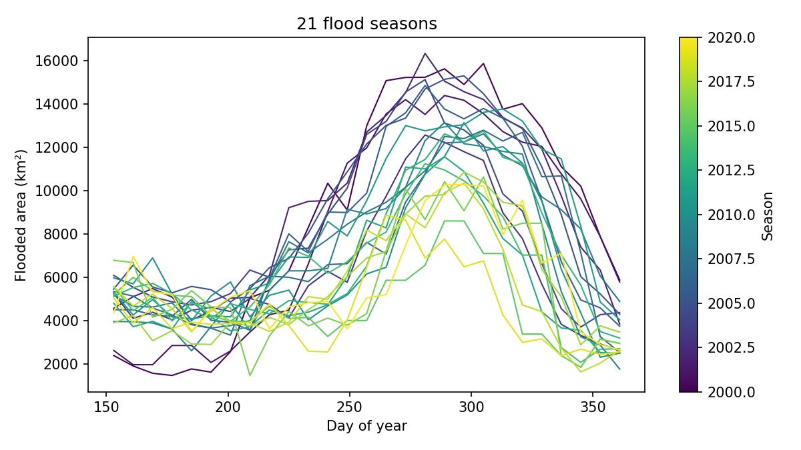

- Trục ngang: ngày trong năm. Trục dọc: km² ngập. Mỗi đường là một mùa; màu tím = năm cũ, vàng = năm gần đây.
- **Đọc được gì:** mọi mùa có cùng hình dạng: phẳng khoảng 4.000–6.000 km² đến ngày ~220, dâng mạnh, đạt đỉnh
  quanh ngày 280–310, rồi rút về ~3.000 km² cuối tháng 12. Đường tím (đầu những năm 2000) cao hơn hẳn đường vàng
  (gần đây): **lũ nhỏ dần qua các năm**.
- **Vì sao quan trọng:** hình dạng chung lặp lại mỗi năm → có thể dùng "trung bình các năm trước" làm mức nền.
  Nhưng mức nền đó phải lấy từ các năm **gần** (vì có xu hướng giảm).

**Hình 2.2 – Bản đồ nhiệt mùa × bước** (`results/AnomAR1/figures/heatmap_season_step.png`)

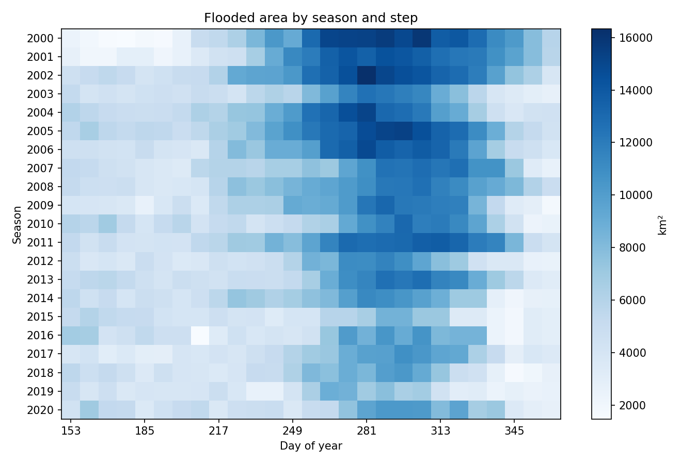

- Mỗi hàng là một mùa, mỗi ô là một bước, màu càng đậm càng ngập nhiều.
- **Đọc được gì:** dải xanh đậm (đỉnh lũ) nằm giữa ngày ~265 và ~330 ở mọi năm, nhưng nhạt dần từ trên xuống
  dưới (năm 2000–2006 đậm nhất, 2015 và 2019 nhạt nhất). Mùa 2015 gần như không có lũ lớn.

**Hình 2.3 – Đỉnh lũ từng năm** (`results/AnomAR1/figures/peak_trend.png`, cùng nội dung ở `results/GAM/figures/fig01_data.png`)

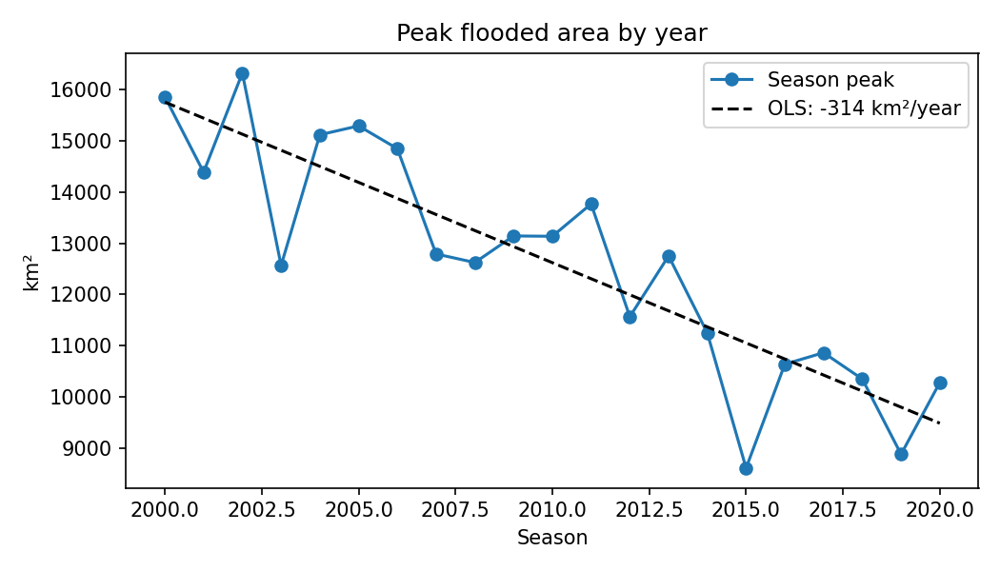

- Mỗi chấm là diện tích ngập lớn nhất của một mùa. Đường đứt: đường thẳng khớp nhất (hồi quy).
- **Số liệu** (`eda_inference.csv`):
  - Độ dốc: **−314 km²/năm**, khoảng tin cậy 95% từ −396 đến −232; R² = 0,77 (đường thẳng giải thích 77% biến động đỉnh).
    p ≈ 7 × 10⁻¹⁴: xu hướng giảm gần như chắc chắn không phải ngẫu nhiên.
  - Mann–Kendall (kiểm định xu hướng không cần giả định phân phối): tau = −0,70, p = 1,6 × 10⁻⁶. Cùng kết luận.
  - So đỉnh trước 2010 với từ 2010 (Mann–Whitney): trung vị 14.619 so với 10.860 km², p = 0,001.
    → **Các mùa test (2010–2020) có lũ nhỏ hơn hẳn các mùa dùng để học**. Đây là khó khăn thật của bài toán.
  - Levene (độ phân tán đỉnh trước/sau 2010): p = 0,89 → độ biến động giữa các năm không đổi, chỉ mức trung bình giảm.
  - Kruskal–Wallis (ngày đạt đỉnh theo cỡ lũ): p = 0,77 → lũ to hay nhỏ thì đỉnh vẫn rơi vào cùng khoảng thời gian.
- Đỉnh cao nhất: 16.328 km² (2002). Thấp nhất: 8.605 km² (2015). Ngày đạt đỉnh: từ ngày 265 (2019) đến 313 (2011), trung vị 297.
- **Không giải thích nguyên nhân** (đê bao, đập thượng nguồn, mưa...): dữ liệu này không đủ để nói nhân quả.

**Hình 2.4 – Phân phối diện tích ngập** (`results/AnomAR1/figures/distribution_boxplots.png`)

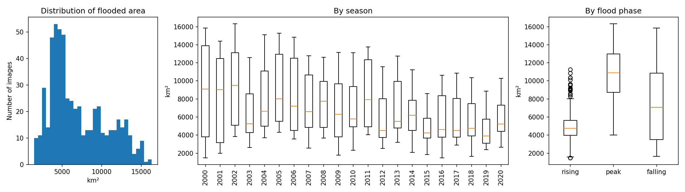

- Trái: histogram 567 giá trị. Lệch phải (độ xiên 0,67): nhiều giá trị quanh 4.000–6.000 (giai đoạn chưa lũ), đuôi dài lên 16.000.
- Giữa: hộp theo mùa. Hộp = khoảng giữa 50% giá trị, vạch cam = trung vị, râu = phạm vi. Hộp các năm gần đây thấp và ngắn hơn.
- Phải: theo giai đoạn lũ (`eda_descriptive.csv`):

| Giai đoạn (theo ngày) | Số ảnh | Trung bình | Độ lệch chuẩn | Nhỏ nhất | Trung vị | Lớn nhất |
|---|--:|--:|--:|--:|--:|--:|
| Tất cả | 567 | 7.003 | 3.555 | 1.476 | 5.792 | 16.328 |
| Nước lên (< ngày 257) | 273 | 5.044 | 1.694 | 1.476 | 4.767 | 11.272 |
| Đỉnh (ngày 257–297) | 126 | 10.779 | 2.824 | 4.016 | 10.903 | 16.328 |
| Nước rút (≥ ngày 298) | 168 | 7.354 | 3.877 | 1.646 | 7.074 | 15.866 |

Giai đoạn **nước rút** có độ lệch chuẩn lớn nhất: năm thì rút nhanh, năm thì rút chậm → khó đoán nhất
(đúng như kết quả các mô hình về sau).

---

## 3. Từ điển nhỏ (đọc trước khi đọc số)

| Thuật ngữ | Nghĩa dễ hiểu | Ký hiệu trong code |
|---|---|---|
| **Mùa** | Một năm lũ, 27 ảnh cách nhau 8 ngày | `season` |
| **Bước** | Một ảnh trong mùa, đánh số 1–27 | `step`, `t` |
| **Gốc dự báo** | "Hôm nay": bước t mà ta đứng đó và nhìn về tương lai. Chỉ biết các bước 1..t của mùa này | `t` |
| **Tầm dự báo** | Nhìn xa bao nhiêu bước: h = 1, 2, 4 bước = **8, 16, 32 ngày** | `h` |
| **Bước đích** | Bước cần đoán: t + h | `doy_target`, `y_target` |
| **Climatology** (mức bình thường) | Trung bình diện tích ngập của **5 mùa liền trước** tại cùng bước. Nếu mới có 3–4 mùa trước thì lấy trung bình 3–4 mùa đó | `c`, `c_t`, `c_target` |
| **Anomaly** (độ lệch) | Diện tích thật trừ mức bình thường: a = y − c. a > 0: năm nay ngập nhiều hơn bình thường | `a_t`, `a_t1` |
| **Fold** | Một lần "học – thi": học trên các mùa trước, thi trên đúng 1 mùa | `test_season` |
| **Cấu hình / siêu tham số** | Các nút vặn của mô hình (độ sâu cây, độ trơn đường cong...) phải chọn trước khi học | `cfg`, `GRID` |
| **Validation** | 3 mùa cuối của tập học, dùng để chọn cấu hình (không bao giờ dùng mùa thi) | `pick_config` |
| **Sai số** | Thật − dự báo (km²) | |
| **MSE** | Trung bình bình phương sai số | |
| **RMSE** | Căn của MSE, đơn vị km². "Sai số điển hình". **Càng nhỏ càng tốt** | `rmse` |
| **Tỉ lệ RMSE** | RMSE mô hình ÷ RMSE AnomAR1. **< 1 là tốt hơn AnomAR1** | `rmse_ratio` |
| **Mùa thắng** | Số mùa (trên 11) mà mô hình có MSE thấp hơn AnomAR1 | `wins` |
| **p-value** | Nếu thật ra hai mô hình ngang nhau, xác suất thấy chênh lệch lớn như vậy (hoặc hơn) chỉ do may rủi. p < 0,05 → coi là khác biệt thật | `p_t`, `p_wilcoxon` |
| **Khoảng tin cậy 95% (CI)** | Khoảng mà giá trị thật nhiều khả năng nằm trong. CI chứa 0 → chưa phân biệt được | `*_ci_low`, `*_ci_high` |
| **Hiệu chỉnh Holm** | Làm nhiều phép so thì dễ "trúng" một cái do may; Holm tăng p lên để bù | `p_t_holm*` |
| **TOST** | Kiểm định "ngang nhau": p nhỏ → có bằng chứng hai mô hình chênh không quá ±5% | `p_tost` |
| **Rò rỉ (leakage)** | Vô tình dùng thông tin tương lai khi dự báo → kết quả đẹp giả | |

---

## 4. Luật chơi chung: thi thế nào cho công bằng

Code: `src/AnomAR1/anomar1_protocol.py` (mỗi mô hình có bản sao luật chơi trong thư mục của mình, ví dụ
`src/GAM/gam_protocol.py`, `src/LightGBM/lightgbm_protocol.py`, `src/Chronos-2/chronos2_protocol.py`; test
đảm bảo chúng cho cùng kết quả).

### 4.1 Học quá khứ, thi tương lai (rolling origin theo năm)

**Hình 4.1 – Sơ đồ chia học/thi** (`results/GAM/figures/fig02_protocol.png`)

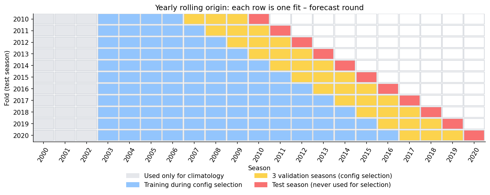

- Mỗi hàng là một fold (một lần thi), mỗi cột là một mùa.
- **Xám** (2000–2002): chỉ dùng để tính mức bình thường cho các mùa sau, không dùng để học, vì chúng chưa có đủ 3 mùa trước.
- **Xanh**: mùa dùng để học khi chọn cấu hình.
- **Vàng**: 3 mùa cuối của tập học, dùng để **chọn cấu hình**.
- **Đỏ**: mùa thi. **Không bao giờ** được dùng để chọn hay học.
- **Trắng**: tương lai, chưa được biết.

Ví dụ fold 2010: học trên 2003–2009 (7 mùa), thi mùa 2010. Fold 2020: học trên 2003–2019 (17 mùa), thi mùa 2020.
Có **11 fold** = **11 mùa thi** (2010–2020).

### 4.2 Ba luật chống nhìn trộm tương lai

1. **Mức bình thường** của một mùa chỉ lấy từ các mùa **trước** nó (không gồm chính nó).
2. Tại gốc t, chỉ biết bước 1..t của mùa đang dự báo.
3. Mọi tham số (φ, hệ số, cây...) và mọi lựa chọn cấu hình chỉ dùng các mùa **trước** mùa thi.

Có test cố ý thay dữ liệu tương lai bằng 10⁹ và kiểm tra dự báo không đổi
(`tests/Chronos-2/test_chronos2_protocol.py`, `test_chronos2_model.py`, `tests/LightGBM/test_lightgbm_pipeline.py`...).

### 4.3 Gốc dự báo nào được tính

- Gốc đầu tiên là **t = 3** (để có đủ 2 bước trễ y_t, y_{t−1}, y_{t−2} cho LightGBM; mọi mô hình dùng cùng tập gốc).
- Gốc cuối là t = 27 − h (để bước đích còn nằm trong mùa).
- Số dự báo mỗi mùa: 24 (h = 1), 23 (h = 2), 21 (h = 4). Trên 11 mùa: **264 + 253 + 231 = 748 dự báo** cho mỗi mô hình.

### 4.4 Chọn cấu hình (công bằng ngân sách)

Mỗi mô hình có đúng **6 cấu hình** cố định (khai báo trước khi xem test). Trong **mỗi** fold và **mỗi** tầm:
1. Học từng cấu hình trên tập học trừ 3 mùa cuối.
2. Chấm MSE trên 3 mùa cuối (validation).
3. Lấy cấu hình có MSE nhỏ nhất, **học lại trên toàn bộ tập học**, rồi dự báo mùa thi.

AnomAR1 không có siêu tham số. Chronos-2 dùng zero-shot nên không chọn gì.

### 4.5 Các bản "chính" được khai báo trước

Để không chọn bản đẹp nhất sau khi xem kết quả, mỗi thành viên khai báo trước **một bản chính**:
`gam`, `lgbm_raw`, `chronos2`. Các bản khác (`gam_w7`, `lgbm_anomaly`, `lgbm_noclim`, `anom_ar1_w7`) là **biến thể phụ**.

---

## 5. Chấm điểm và kiểm định

Code: `*_evaluate.py` của từng mô hình và `src/Comparison/comparison_tables.py`.

### 5.1 RMSE gộp

Gộp mọi dự báo của 11 mùa ở một tầm, lấy căn của trung bình bình phương sai số.
Ví dụ AnomAR1 ở 8 ngày: RMSE = **1.090 km²** nghĩa là "sai điển hình khoảng 1.090 km²", tức khoảng 15% so với
diện tích ngập trung bình (7.003 km²).

Bảng: `results/<Model>/tables/rmse.csv` (dòng = mô hình, cột 1/2/4 = tầm), và gộp mọi mô hình ở
`results/Comparison/tables/rmse_all.csv`.

### 5.1b R² gộp

R² = 1 − SSE/SST: tỉ lệ biến động của diện tích ngập (quanh trung bình của mọi ngày đích ở cùng tầm) mà dự báo giải thích được.
Ở cùng một tầm mọi mô hình dự báo đúng cùng các dòng, nên SST là chung: R² chỉ là RMSE viết lại theo thang 0–1
(R² cao hơn ⇔ RMSE thấp hơn), không thêm thông tin mới nhưng dễ đọc hơn. R² âm nghĩa là tệ hơn cả việc đoán bằng trung bình.
Bảng: `results/Comparison/tables/r2_all.csv` (cùng dạng `rmse_all.csv`).

### 5.2 Vì sao kiểm định theo **mùa** (n = 11) chứ không theo 748 dự báo

Sai số của các bước liền nhau trong cùng mùa rất giống nhau (năm nay đoán cao ở bước 10 thì bước 11 cũng thường cao).
Coi 748 dự báo là 748 quan sát độc lập sẽ "thổi phồng" bằng chứng và cho p-value nhỏ giả tạo.
Đơn vị độc lập hợp lý là **mùa**: mỗi mô hình có 11 giá trị MSE (một cho mỗi mùa thi), so từng cặp với AnomAR1.

### 5.3 Các cột của bảng `vs_anom_ar1.csv`

Mỗi dòng = một mô hình ở một tầm, so với AnomAR1 trên 11 mùa:

| Cột | Cách tính | Đọc thế nào |
|---|---|---|
| `n_seasons` | 11 | số mùa thi |
| `rmse_ratio` | √(trung bình MSE mô hình ÷ trung bình MSE AnomAR1) | < 1 là tốt hơn. 0,93 = sai số nhỏ hơn 7% |
| `wins` | số mùa có MSE thấp hơn AnomAR1 | 9 = thắng 9/11 mùa |
| `mse_diff_pct` | trung bình qua 11 mùa của (MSE mô hình − MSE AnomAR1) / MSE AnomAR1, ×100 | âm là tốt hơn |
| `mse_diff_pct_ci_low/high` | khoảng tin cậy 95% của cột trên (phân phối t, 10 bậc tự do) | chứa 0 → chưa phân biệt được |
| `p_t` | **t-test cặp** trên 11 cặp MSE | p < 0,05 → khác biệt thật (trước hiệu chỉnh) |
| `p_wilcoxon` | Wilcoxon cặp: như t-test nhưng chỉ dùng thứ hạng, không cần giả định phân phối chuẩn | kiểm tra chéo cho `p_t` |
| `p_tost` | TOST trên log tỉ lệ RMSE từng mùa, biên ±5% | p < 0,05 → **có bằng chứng ngang nhau** |
| `p_t_holm` | Holm hiệu chỉnh `p_t` trong các phép so của **thư mục mô hình đó** | |
| `p_t_holm_main` | Holm trên **9 phép so của họ chính** (chỉ ở `results/Comparison/`) | **con số dùng để kết luận** |

**Lưu ý quan trọng: `rmse_ratio` và `mse_diff_pct` có thể "trái chiều".** Ví dụ LightGBM ở 32 ngày:
`rmse_ratio` = 1,001 (gần như bằng) nhưng `mse_diff_pct` = +11,8%. Lý do: `rmse_ratio` gộp mọi mùa (mùa lũ to
có sai số lớn nên nặng ký), còn `mse_diff_pct` là trung bình phần trăm từng mùa, nên vài mùa rất tệ (2011:
RMSE gấp 1,57 lần, tức MSE gấp 2,46 lần) kéo trung bình lên. Hai cột trả lời hai câu hỏi khác nhau, cả hai đều đúng.

### 5.4 TOST: chứng minh "ngang nhau"

"Không khác có ý nghĩa" **không** có nghĩa là "ngang nhau": có thể chỉ là chưa đủ dữ liệu.
TOST lật ngược câu hỏi: giả thuyết là "chênh ít nhất 5%"; nếu bác bỏ được (p < 0,05) thì mới nói
"hai mô hình ngang nhau trong biên ±5% RMSE". Cụ thể, với mỗi mùa tính d = ½·ln(MSE mô hình / MSE AnomAR1)
(= log tỉ lệ RMSE), rồi làm hai kiểm định một phía so với ±ln(1,05).

### 5.5 Hiệu chỉnh Holm và "họ chính"

**Vấn đề:** làm 9 phép so ở mức 5% thì ngay cả khi mọi mô hình thực ra ngang nhau, khả năng có ít nhất một
p < 0,05 do may lên tới khoảng 1 − 0,95⁹ ≈ 37%.

**Holm–Bonferroni:** xếp p từ nhỏ đến lớn; p nhỏ nhất nhân 9, p thứ hai nhân 8, ... (và không để p sau nhỏ hơn p trước, không vượt 1).

**Họ chính** (khai báo cố định, không chọn theo kết quả): 3 bản chính (`gam`, `lgbm_raw`, `chronos2`) × 3 tầm = **9 phép so**.
Biến thể và mốc ngây thơ là phân tích phụ: không vào họ chính, giữ Holm trong thư mục của mô hình đó.

**Tính tay trên số thật** (`results/Comparison/tables/vs_anom_ar1_main.csv`):
- p nhỏ nhất: Chronos-2 ở 32 ngày, p_t = 0,005035 → × 9 = **0,0453** < 0,05 → **vẫn có ý nghĩa**.
- p thứ hai: LightGBM ở 16 ngày, p_t = 0,1397 → × 8 = 1,12 → cắt về **1**.
- Mọi p còn lại cũng thành 1.

Mỗi thư mục mô hình cũng có Holm riêng (`p_t_holm`), với họ nhỏ hơn: GAM 3 phép, Chronos-2 3 phép, LightGBM 9 phép
(3 biến thể × 3 tầm), AnomAR1 9 phép (3 mốc phụ × 3 tầm). Ví dụ Chronos-2 ở 32 ngày: Holm trong thư mục = 0,0151,
Holm họ chính = 0,0453. **Báo cáo và video trích con số họ chính.**

---

## 6. Các mô hình

**Một ví dụ dùng xuyên suốt:** fold 2016, đứng ở gốc t = 11 (ngày 233), dự báo trước 16 ngày (h = 2) cho ngày 249.

| | Giá trị |
|---|--:|
| Diện tích hôm nay y_t (ngày 233, mùa 2016) | 3.768,7 km² |
| Mức bình thường hôm nay c_t (trung bình 2011–2015, ngày 233) | 5.463,0 km² |
| Độ lệch hôm nay a_t = y_t − c_t | **−1.694,3 km²** (năm 2016 ngập ít hơn bình thường) |
| Mức bình thường tại ngày đích c_target (ngày 249) | 5.992,5 km² |
| **Giá trị thật ngày 249** | **3.803,2 km²** |

Dự báo của từng mô hình cho điểm này (`results/*/tables/predictions.csv`, season 2016, h 2, t 11):

| Mô hình | Dự báo | Sai số (thật − dự báo) |
|---|--:|--:|
| Persistence | 3.768,7 | +34,5 |
| Clim5 | 5.992,5 | −2.189,3 |
| AnomAR1 | 4.546,8 | −743,6 |
| GAM | 4.084,1 | −280,9 |
| LightGBM (thô) | 4.498,6 | −695,4 |
| Chronos-2 | 4.279,5 | −476,2 |

(Ở điểm này Persistence trúng nhất, nhưng đó là may: tính trên cả 748 dự báo, nó tệ nhất, xem 6.1.)

### 6.1 Hai mốc ngây thơ: Persistence và Clim5

Code: `src/AnomAR1/anomar1_protocol.py::persistence`, `::clim5`.

- **Persistence** ("không đổi"): dự báo = diện tích hôm nay. Tốt khi nhìn gần, tệ khi nhìn xa vì lũ thay đổi nhanh.
- **Clim5** ("trung bình 5 năm"): dự báo = mức bình thường tại ngày đích, bỏ qua hôm nay. Không phụ thuộc tầm.

| | 8 ngày | 16 ngày | 32 ngày |
|---|--:|--:|--:|
| Persistence | 1.312 | 2.068 | 3.456 |
| Clim5 | 1.812 | 1.845 | 1.916 |
| AnomAR1 | 1.090 | 1.375 | 1.687 |

So với AnomAR1 (`results/AnomAR1/tables/vs_anom_ar1.csv`):
- Persistence kém hơn có ý nghĩa ở cả 3 tầm (p Holm = 0,030 / 0,002 / 0,0002; thắng 1, 0, 0 mùa).
- Clim5 kém hơn về số ở mọi tầm (tỉ lệ 1,66 / 1,34 / 1,14) nhưng sau Holm chưa có ý nghĩa (0,115 / 0,233 / 0,505).
  Lý do: với n = 11, khác biệt phải rất đều mới qua được; Clim5 thắng 5/11 mùa ở 32 ngày.

**Ý nghĩa:** AnomAR1 kết hợp ưu điểm của cả hai: gần thì tin "hôm nay", xa thì tin "bình thường".

### 6.2 AnomAR1 – mốc chính

Code: `src/AnomAR1/` (đọc theo thứ tự `anomar1_data.py` → `anomar1_protocol.py` → `anomar1_forecast.py` →
`anomar1_evaluate.py` → `anomar1_diagnostics.py`). Notebook: `notebooks/AnomAR1/anomar1_overview.ipynb` (bản EN: `_en`).

#### Công thức

```
dự báo(t + h) = c(t + h)  +  φ^h × a(t)
                ─────────     ──────────
                mức bình       độ lệch hôm nay,
                thường tại     tắt dần theo cấp số nhân
                ngày đích
```

- Giả định: độ lệch là một quá trình **AR(1)**: a(t) ≈ φ × a(t − 1) + nhiễu. Nên sau h bước còn lại φ^h × a(t).
- φ (phi) ước lượng bằng **hồi quy qua gốc tọa độ**: φ = Σ x·y / Σ x², với x = a(t − 1), y = a(t), chỉ trên các dòng của mùa học.
- Ước lượng lại φ cho **mỗi mùa thi và mỗi tầm** (vì tập dòng học hơi khác nhau giữa các tầm).

**Ví dụ tay** (fold 2016, h = 2): φ = 0,9237 (từ 299 dòng học, mùa 2003–2015), φ² = 0,8533.
Dự báo = 5.992,5 + 0,8533 × (−1.694,3) = 5.992,5 − 1.445,7 = **4.546,8 km²**. Khớp với `predictions.csv`.

#### Kết quả (`results/AnomAR1/tables/rmse.csv`)

| Mô hình | 8 ngày | 16 ngày | 32 ngày |
|---|--:|--:|--:|
| AnomAR1 | 1.090 | 1.375 | 1.687 |
| AnomAR1, chỉ học 7 mùa gần nhất (`anom_ar1_w7`) | 1.084 | 1.355 | 1.682 |

Bản 7 mùa ngang AnomAR1 đầy đủ trong biên ±5% ở cả 3 tầm (p TOST < 0,01). Ở 16 ngày nó còn thắng 9/11 mùa (p thô = 0,021)
nhưng sau Holm thì không có ý nghĩa (0,115).

#### Hình

**Hình 6.1 – φ theo từng fold** (`results/AnomAR1/figures/phi_by_fold.png`, số ở `phi_by_fold.csv`)

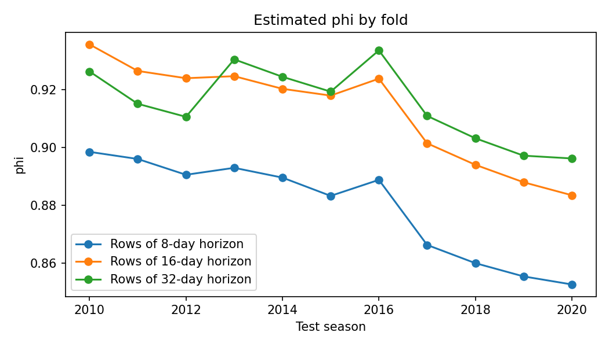

- Mỗi đường là φ ước lượng trên các dòng học của một tầm, theo mùa thi.
- φ khá ổn định: 0,853–0,898 (tầm 8 ngày), 0,884–0,936 (16 ngày), 0,896–0,933 (32 ngày). Từ 2017 giảm rõ: các năm gần đây độ lệch tắt nhanh hơn.
- Hệ số thật sự dùng là φ^h: 0,85–0,90 (8 ngày), 0,78–0,88 (16 ngày), 0,65–0,76 (32 ngày). Tức sau 32 ngày còn giữ khoảng 2/3 độ lệch hôm nay.
- Sai số chuẩn của φ khoảng 0,03–0,05 (`phi_se`); `phi_statsmodels` khớp `phi` tới 10⁻¹⁵ (kiểm chứng bằng thư viện statsmodels).

**Hình 6.2 – Dự báo AnomAR1 ở 2 mùa** (`results/AnomAR1/figures/typical_seasons.png`)

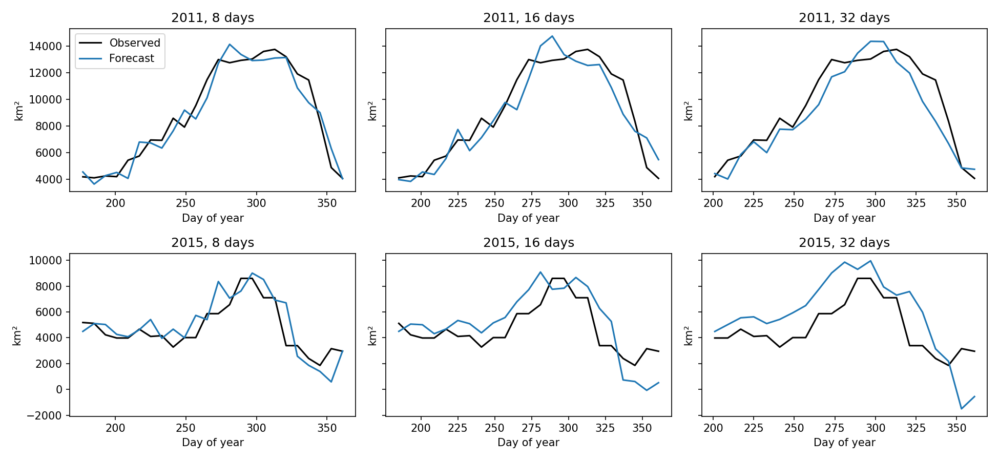

- Đen: thật. Xanh: dự báo AnomAR1. Hàng trên: 2011 (mùa có đỉnh cao nhất trong 11 mùa thi). Hàng dưới: 2015 (thấp nhất).
- Ở 8 ngày, đường dự báo bám sát nhưng **trễ một nhịp** (đặc trưng của mọi mô hình dựa vào "hôm nay").
- Ở 32 ngày, mùa 2015 bị đoán **cao hơn hẳn** từ ngày 230 đến 330: vì mức bình thường (trung bình 2010–2014, lũ to) cao hơn năm 2015 rất nhiều.
- Cuối mùa 2015 (ngày ~350), dự báo xuống **dưới 0 km²** (vô lý vật lý). Lý do: độ lệch âm lớn nhân φ^h cộng vào mức bình thường đã thấp.
  Toàn bộ dự báo âm: AnomAR1 8 lần, Chronos-2 15, GAM 6, lgbm_anomaly 5, gam_w7 3, anom_ar1_w7 2. Nhóm **không cắt về 0**
  để giữ đúng giao thức chung (cắt sẽ giúp một số mô hình hơn mô hình khác).

**Hình 6.3 – Chẩn đoán phần dư** (`results/AnomAR1/figures/residual_diagnostics.png`)

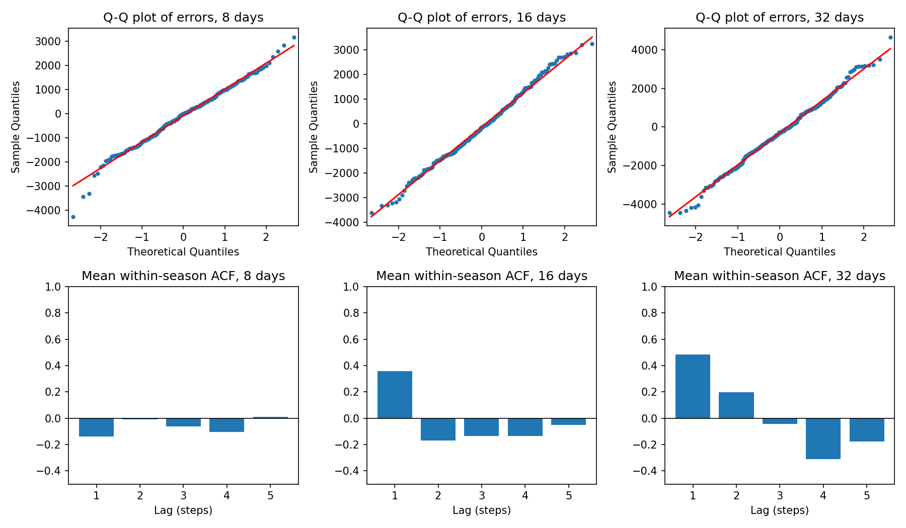

- Hàng trên (Q–Q): nếu các chấm nằm trên đường đỏ thì sai số có phân phối gần chuẩn. Ở đây gần thẳng, chỉ hơi lệch ở hai đầu → t-test dùng được.
- Hàng dưới (ACF): tương quan giữa sai số bước này và bước sau trong cùng mùa (trung bình 11 mùa).
  - 8 ngày: ≈ −0,14 ở độ trễ 1: gần như không còn cấu trúc.
  - 16 ngày: +0,36; 32 ngày: +0,48. Đây là chuyện **bình thường**: dự báo 32 ngày từ hai gốc liền nhau dùng thông tin gần giống nhau, nên sai số nối nhau.
    Đây chính là lý do kiểm định ở cấp mùa ([5.2](#52-vì-sao-kiểm-định-theo-mùa-n--11-chứ-không-theo-748-dự-báo)).
- Bảng `residual_summary.csv`: thiên lệch trung bình −84 / −130 / −302 km² (âm = dự báo **cao** hơn thật, vì lũ đang nhỏ dần
  nên mức bình thường "nhớ" năm to). Số mùa có Ljung–Box p < 0,05 (còn tự tương quan): 0 / 4 / 7 trên 11.

**Bảng phụ `phi_direct_sensitivity.csv`:** thay φ^h bằng một φ ước lượng trực tiếp cho tầm h (hồi quy a(t+h) theo a(t))
cho RMSE 1.088 / 1.356 / 1.675, tốt hơn chút ít. Nhóm giữ φ^h vì nó là định nghĩa gốc của mốc, khai báo trước.

**Bảng lịch sử `trace_1602.csv`:** truy vết vì sao một báo cáo cũ ghi RMSE AnomAR1 ở 32 ngày là 1.602 trong khi hiện tại là 1.687.
Khác biệt đến từ việc chọn gốc đầu tiên (t = 1 so với t = 3) và cách xử lý dữ liệu cũ. Số hiện tại (t = 3) là số chính thức,
vì mọi mô hình phải dùng cùng tập gốc. Script tạo bảng này đã gỡ khỏi repo (đầu vào không còn), lấy lại ở commit `db99215`.

### 6.3 GAM – mô hình cộng tổng quát

Code: `src/GAM/` (`gam_data.py`, `gam_protocol.py`, `gam_model.py`, `gam_common.py`; chạy `gam_build_dataset.py` →
`gam_run_model.py` → `gam_analysis.py` → `gam_figures.py`). Notebook: `notebooks/GAM/gam_overview.ipynb`.

#### Ý tưởng

```
a(t + h) ≈ β0 + s(ngày đích) + β1 × a(t) + β2 × a(t − 1)
dự báo   = c(t + h) + a(t + h) dự báo
```

- s(·) là một **đường cong trơn** (spline có phạt) theo ngày trong năm: mô hình tự học hình dạng.
- β1, β2: hệ số tuyến tính cho độ lệch hôm nay và 8 ngày trước.
- AnomAR1 là trường hợp đặc biệt của GAM (β0 = 0, s = 0, β2 = 0, β1 = φ^h). Nên GAM trả lời câu hỏi:
  **"cho phép sửa lệch theo mùa vụ và theo hai bước trễ có giúp gì không?"**
- Thư viện: `pygam.LinearGAM`. 2 siêu tham số của s(·): `n_splines` (độ mềm tối đa) và `lam` (phạt độ cong, càng lớn càng phẳng).
  Lưới 6 cấu hình: (6; 0,1), (6; 1), (8; 0,6), (8; 5), (12; 1), (12; 10).

**Hình 6.4 – Một dự báo GAM, tách từng phần** (`results/GAM/figures/fig03_one_forecast.png`)

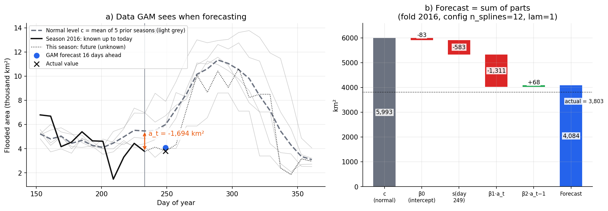

- Trái: GAM nhìn thấy gì. Đường đen đậm = mùa 2016 đến hôm nay (ngày 233). Đường xám đứt = mức bình thường. Chấm xanh = dự báo 16 ngày sau, X = giá trị thật.
- Phải: dự báo = tổng các phần, đúng ví dụ chung của mục 6:
  c = 5.993; β0 = −83; s(ngày 249) = −583; β1·a_t = −1.311; β2·a_{t−1} = +68 → **4.084** (thật 3.803).
- So với AnomAR1 (4.547), GAM gần thật hơn nhờ phần s(ngày) = −583: "quanh ngày 249, các năm gần đây hay ngập ít hơn mức bình thường".

**Hình 6.5 – Cấu hình được chọn** (`results/GAM/figures/fig04_config_selection.png`, bảng `gam_chosen_configs.csv`)

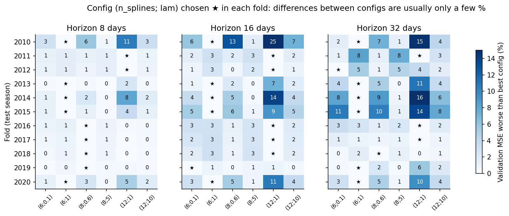

- Mỗi ô: MSE validation của cấu hình đó tệ hơn cấu hình tốt nhất bao nhiêu %. ★ = cấu hình được chọn.
- Đa số ô 0–5%: chọn cấu hình nào cũng không chênh nhiều. Cấu hình (6; 1) được chọn 16/33 lần, (12; 1) 10 lần, (8; 0,6) 5 lần, (6; 0,1) 2 lần.

**Hình 6.6 – Hệ số qua các fold** (`results/GAM/figures/fig05_coefficients.png`, bảng `gam_coefficients.csv`)

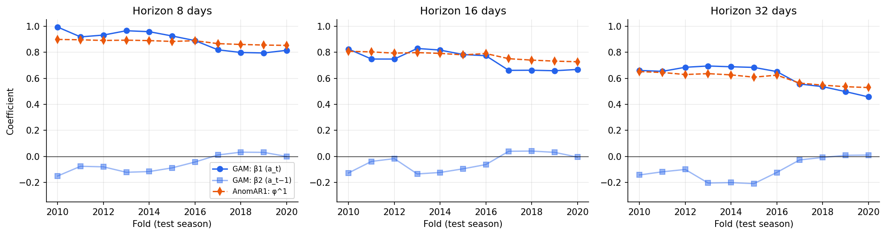

- β1 (xanh đậm) giảm theo tầm: trung bình 0,89 (8 ngày) → 0,74 (16 ngày) → 0,62 (32 ngày); rất sát φ^h của AnomAR1 (cam).
  → GAM học lại đúng "độ lệch tắt dần" mà AnomAR1 giả định.
- β2 (xanh nhạt) gần 0 (trung bình −0,05 / −0,05 / −0,10): bước trễ thứ hai gần như không thêm thông tin.
- Bậc tự do hiệu dụng của s(·) ≈ 3,7–4,2: đường cong khá đơn giản.
- R² giả (`r2_pseudo`): 0,74 / 0,53 / 0,26: càng xa càng khó giải thích độ lệch tương lai.

**Hình 6.7 – Đường cong theo ngày s(·)** (`results/GAM/figures/fig06_seasonal_curve.png`, bảng `gam_seasonal_curve.csv`, `climatology_bias.csv`)

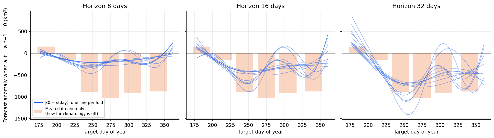

- Đường xanh: β0 + s(ngày) ở mỗi fold = độ lệch GAM dự báo khi hôm nay "bình thường" (a_t = a_{t−1} = 0).
- Cột cam: độ lệch trung bình thật của dữ liệu theo khoảng ngày. Từ ngày ~230 trở đi, độ lệch trung bình khoảng **−880 đến −1.030 km²**
  (`climatology_bias.csv`): mức bình thường 5 năm trước **luôn cao hơn thật**, vì đỉnh lũ giảm 314 km²/năm.
- s(·) học đúng phần sửa lệch này (xuống âm sau ngày 230).

#### Kết quả

| | 8 ngày | 16 ngày | 32 ngày |
|---|--:|--:|--:|
| AnomAR1 | 1.090 | 1.375 | 1.687 |
| GAM | 1.096 | 1.372 | 1.688 |
| GAM, 7 mùa gần nhất (`gam_w7`) | 1.090 | 1.378 | 1.711 |

So với AnomAR1 (`results/GAM/tables/vs_anom_ar1.csv`): tỉ lệ 1,006 / 0,997 / 1,001; thắng 5 / 7 / 7 mùa; p thô 0,51 / 0,91 / 0,99.
**Ở 8 ngày, p TOST = 0,0017: có bằng chứng GAM và AnomAR1 ngang nhau trong ±5%.** Ở 16 và 32 ngày, p TOST = 0,053 và 0,253: chưa đủ để gọi là ngang nhau.

**Hình 6.8 – RMSE gộp** (`results/GAM/figures/fig07_rmse.png`): 4 nhóm cột (Persistence, Clim5, AnomAR1, GAM) ở 3 tầm. Cột AnomAR1 và GAM gần như bằng nhau.

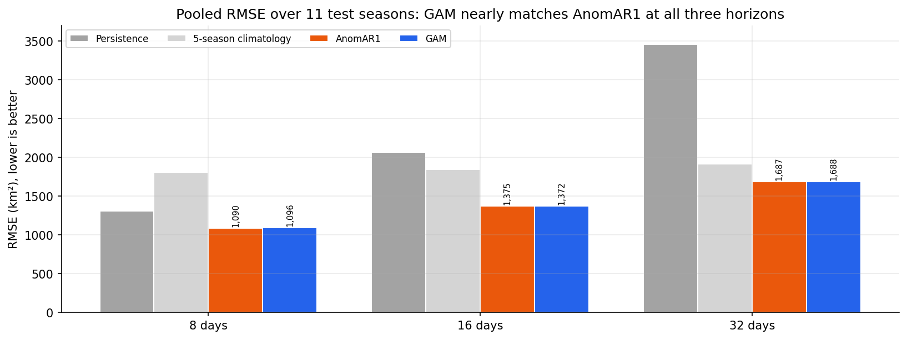

**Hình 6.9 – Tỉ lệ RMSE từng mùa** (`results/GAM/figures/fig08_season_ratio.png`, bảng `gam_season_rmse.csv`)

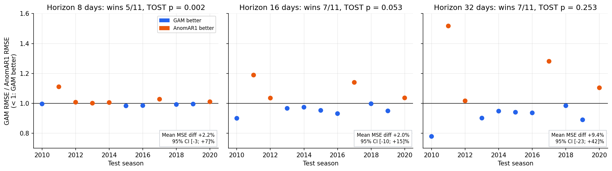

- Mỗi chấm là một mùa: xanh = GAM tốt hơn, cam = AnomAR1 tốt hơn.
- 8 ngày: mọi chấm sát 1 (trừ 2011: 1,11). 32 ngày: phân tán mạnh, 2011 là 1,52, 2017 là 1,28, nhưng 2010 là 0,78.
- **Đọc được gì:** trung bình gần 1 nhưng từng mùa chênh lớn → GAM không đều hơn AnomAR1.

**Hình 6.10 – Theo điều kiện** (`results/GAM/figures/fig09_conditions.png`): xem [mục 8](#8-theo-điều-kiện-khi-nào-mô-hình-nào-khá-hơn).
GAM khá hơn khi nước lên (32 ngày: 1.251 so với 1.357), kém hơn chút ở đỉnh và khi nước rút; bù trừ nên tổng gần bằng.

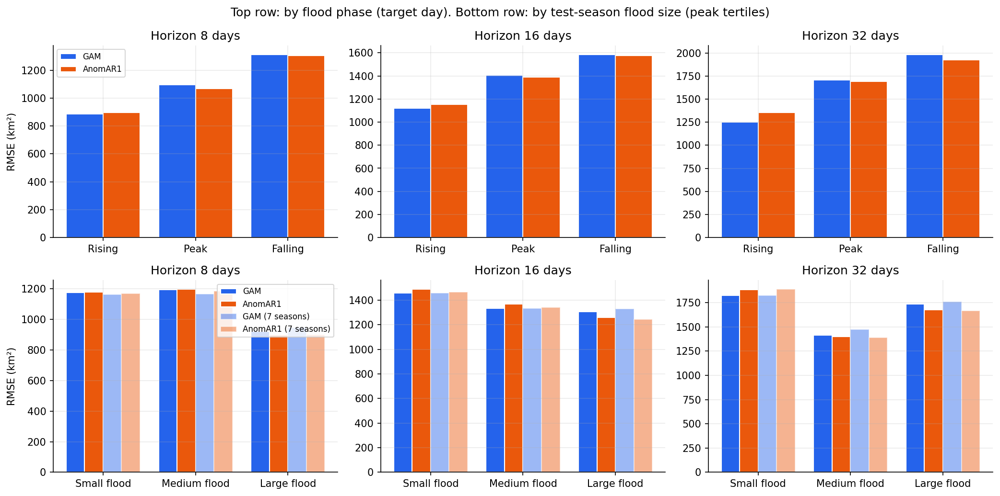

**Hình 6.11 – Phần dư GAM** (`results/GAM/figures/fig10_residuals.png`, bảng `gam_residual_summary.csv`)

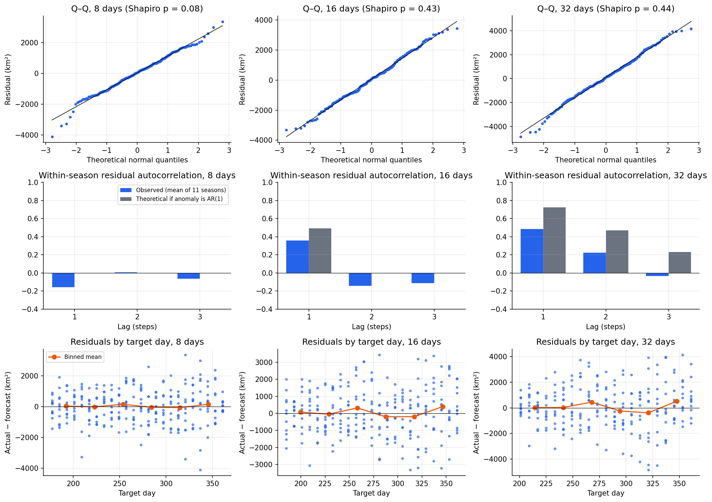

- Hàng 1, Q–Q: Shapiro p = 0,08 / 0,43 / 0,44 → không bác bỏ phân phối chuẩn.
- Hàng 2, ACF quan sát (xanh) so với lý thuyết nếu độ lệch đúng là AR(1) (xám): quan sát **thấp hơn** lý thuyết → phần dư ít "dính" hơn mong đợi, không có dấu hiệu bỏ sót cấu trúc.
- Hàng 3, phần dư theo ngày đích: đường trung bình (cam) quanh 0 ở mọi khoảng ngày → s(·) đã sửa được lệch theo mùa.
  Thiên lệch trung bình của GAM: +34 / +67 / +105 km² (nhỏ hơn và ngược dấu so với AnomAR1).

**Hình 6.12 – Hai mùa đối lập** (`results/GAM/figures/fig11_two_seasons.png`)

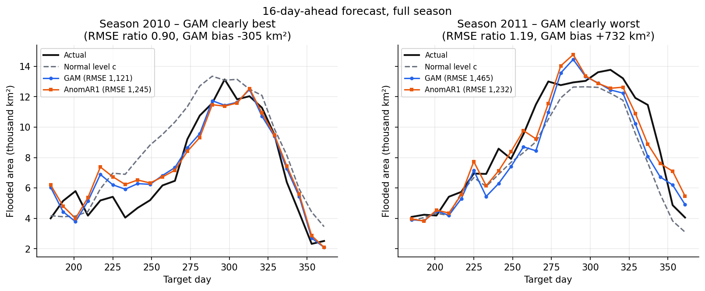

- 2010: GAM tốt hơn rõ nhất (tỉ lệ 0,90): mức bình thường (xám đứt) cao hơn thật từ ngày 225–275, GAM kéo dự báo xuống đúng hướng.
- 2011: GAM kém hơn rõ nhất (1,19): năm này lũ **to** hơn bình thường, nhưng GAM vẫn kéo xuống theo thói quen của các năm lũ nhỏ.
  → Phần sửa lệch theo mùa giúp khi xu hướng giảm tiếp diễn, hại khi gặp năm bất thường.

**Hình 6.13 – Bóc tách (phần phụ)** (`results/GAM/figures/fig12_ablation.png`, bảng `gam_ablation_rmse.csv`)

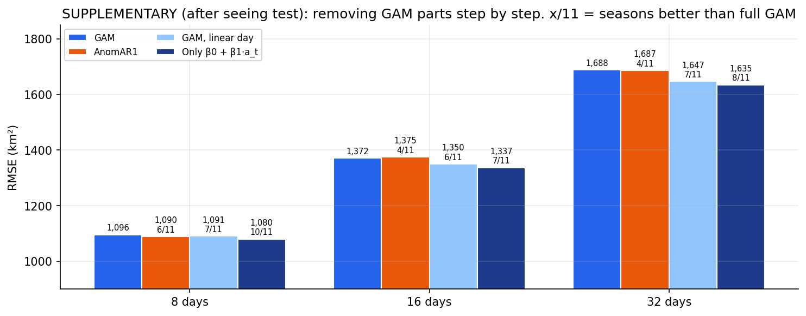

- **Làm sau khi đã xem kết quả test**, chỉ để hiểu, **không vào bảng chính**.
- Bỏ dần các phần của GAM: thay s(ngày) bằng đường thẳng (1.091 / 1.350 / 1.647); chỉ giữ β0 + β1·a_t (1.080 / 1.337 / 1.635).
  Bản đơn giản nhất lại tốt nhất, thắng GAM gốc 10/11 mùa ở 8 ngày.
- **Ý nghĩa:** lợi ích không đến từ đường cong phức tạp; nếu muốn dùng bản đơn giản này làm bản chính thì phải khai báo trước và chạy lại cho cả nhóm.

### 6.4 LightGBM – cây tăng cường

Code: `src/LightGBM/` (`lightgbm_data.py`, `lightgbm_protocol.py`, `lightgbm_model.py`; chạy `lightgbm_forecast.py` →
`lightgbm_evaluate.py` → `lightgbm_diag.py`). Notebook: `notebooks/LightGBM/lightgbm_overview.ipynb`, chẩn đoán đầy đủ: `thien_lightgbm.ipynb`.

#### Ý tưởng

**Gradient boosting:** dựng nhiều cây quyết định nhỏ nối tiếp, mỗi cây sửa phần sai của các cây trước.
Mỗi gốc dự báo là một dòng dữ liệu; mô hình học quan hệ "đặc trưng hôm nay → diện tích ngày đích" từ các mùa trước.

Ba biến thể **khai báo trước**:

| Biến thể | Đặc trưng đầu vào | Dự báo gì |
|---|---|---|
| `lgbm_raw` (**bản chính**) | y_t, y_{t−1}, y_{t−2}, c_t, c_target, ngày đích | diện tích ở ngày đích |
| `lgbm_anomaly` | a_t, a_{t−1}, ngày đích | độ lệch ở ngày đích, rồi cộng c_target |
| `lgbm_noclim` | y_t, y_{t−1}, y_{t−2}, ngày đích (**không** mức bình thường) | diện tích ở ngày đích |

- Lưới 6 cấu hình (số lá, số cây, tốc độ học): (4, 200, 0,05), (4, 100, 0,05), (8, 200, 0,05), (4, 400, 0,03), (2, 300, 0,05), (8, 100, 0,1).
  Cố định: `min_child_samples = 10`, `subsample = 0,8`, **seed 0**.
- Cấu hình được chọn cho `lgbm_raw` (33 lần): (2, 300, 0,05) 12 lần, (4, 400, 0,03) 8, (4, 200, 0,05) 7, (4, 100, 0,05) 6. Cây rất nông (2–4 lá) thắng: dữ liệu ít, mô hình đơn giản tốt hơn.

#### Kết quả (`results/LightGBM/tables/rmse.csv`, `vs_anom_ar1.csv`)

| | 8 ngày | 16 ngày | 32 ngày |
|---|--:|--:|--:|
| AnomAR1 | 1.090 | 1.375 | 1.687 |
| **LightGBM thô** | **1.051** | **1.284** | 1.688 |
| LightGBM anomaly | 1.101 | 1.364 | 1.699 |
| LightGBM không climatology | 1.059 | 1.301 | 1.778 |

- `lgbm_raw`: tỉ lệ 0,965 / 0,934 / 1,001; thắng 5 / **9** / 5 mùa; p thô 0,41 / 0,14 / 0,99; mọi p sau Holm = 1.
- Chênh MSE trung bình −4,9% (CI −18,7% đến +8,9%), −5,3% (−27,0% đến +16,4%), +11,8% (−23,9% đến +47,5%). Khoảng tin cậy rất rộng và đều chứa 0.
- `lgbm_noclim` tốt ở 8–16 ngày nhưng tệ ở 32 ngày (1.778): **nhìn xa thì cần mức bình thường**.

**Hình 6.14 – Ổn định theo seed** (`results/LightGBM/figures/seed_rmse.png`, bảng `lightgbm_seed_summary.csv`)

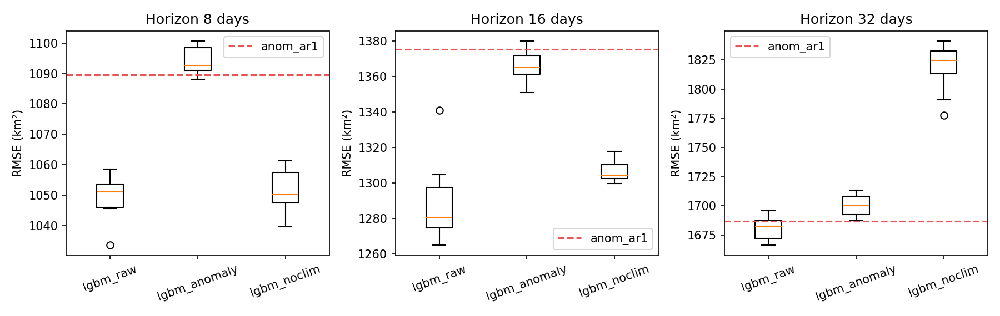

- Chạy lại với 10 seed khác nhau (seed chỉ đổi việc lấy mẫu con khi học). Mỗi hộp là RMSE của 10 lần. Đường đỏ đứt = AnomAR1.
- Độ lệch chuẩn RMSE chỉ 0,4–1,7%. `lgbm_raw` thấp hơn AnomAR1 ở **10/10 seed** tại 8 và 16 ngày, 7/10 seed tại 32 ngày.
- **Ý nghĩa:** lợi thế ở 8–16 ngày không phải do may một seed. Nhưng ổn định theo seed ≠ có ý nghĩa thống kê (vẫn chỉ 11 mùa).

**Hình 6.15 – Mô hình dựa vào đặc trưng nào** (`results/LightGBM/figures/shap_h2.png`, bảng `lightgbm_feature_importance.csv`, `lightgbm_permutation_summary.csv`)

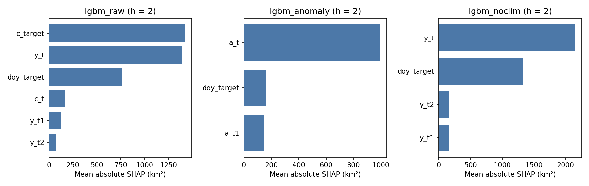

- **SHAP**: mỗi đặc trưng đóng góp trung bình bao nhiêu km² vào dự báo (tầm 16 ngày). `lgbm_raw` dựa nhiều nhất vào `c_target`
  (mức bình thường tại ngày đích) và `y_t` (hôm nay), rồi đến ngày đích. Các bước trễ y_{t−1}, y_{t−2} gần như không dùng.
- **Permutation importance** (xáo trộn một đặc trưng, xem RMSE tăng bao nhiêu), `lgbm_raw`:
  - 8 ngày: xáo `y_t` làm RMSE tăng 1.871 km²; `doy_target` +445; `c_target` +379.
  - 16 ngày: `y_t` +1.018; `c_target` +897; `doy_target` +585.
  - 32 ngày: `c_target` **+1.455**; `doy_target` +335; `y_t` chỉ +179.
  → Gần: tin "hôm nay". Xa: tin "bình thường". Chính là logic của AnomAR1, nhưng LightGBM tự học được và linh hoạt hơn.
- Đây là mô tả mô hình học gì, **không** phải quan hệ nhân quả.

**Hình 6.16 – Lợi thế theo giai đoạn, từng mùa** (`results/LightGBM/figures/phase_ratio_by_season_h2.png`, bảng `lightgbm_phase_by_season_h2.csv`)

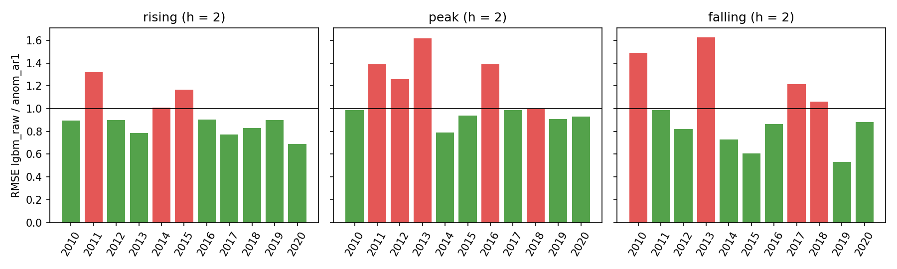

- Mỗi cột: RMSE `lgbm_raw` ÷ AnomAR1 trong một giai đoạn của một mùa (16 ngày). Xanh < 1 = LightGBM tốt hơn.
- Nước lên: thắng 8/11 mùa. Đỉnh: thua nhiều mùa (2011, 2012, 2013, 2016). Nước rút: thắng 7/11 nhưng **không đều**:
  3 mùa (2015, 2019, 2012) đóng góp khoảng 74% tổng mức giảm sai số bình phương khi nước rút.

**Hình 6.17 – Hai mùa ví dụ** (`results/LightGBM/figures/season_examples.png`)

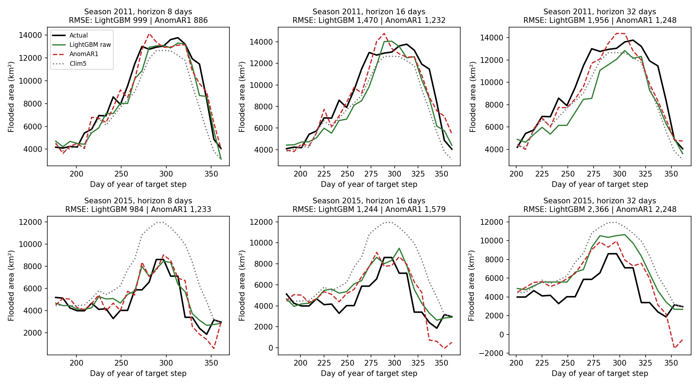

- 2011 (lũ to bất thường): LightGBM kém AnomAR1 ở mọi tầm (32 ngày: 1.956 so với 1.248): **cây không ngoại suy được**, không dự báo vượt quá
  mức đã thấy trong dữ liệu học gần đây.
- 2015 (lũ nhỏ nhất): LightGBM tốt hơn ở 8–16 ngày (16 ngày: 1.244 so với 1.579) và **không đoán âm** cuối mùa như AnomAR1.

**Bảng phụ `lightgbm_vs_rf_fixed_configs_h2.csv`:** so với Random Forest cùng đặc trưng ở 16 ngày. RF tốt nhất 1.388 km², LightGBM
lưới nhóm 1.256–1.315: LightGBM khá hơn, chủ yếu nhờ phần nước rút (RF bị thiên lệch +570 đến +740 km² khi nước rút).

### 6.5 Chronos-2 – mô hình nền zero-shot

Code: `src/Chronos-2/` (`chronos2_data.py`, `chronos2_protocol.py`, `chronos2_model.py`; chạy `chronos2_forecast.py` →
`chronos2_evaluate.py`; phụ: `chronos2_finetune_check.py`). Notebook: `notebooks/Chronos-2/chronos2_overview.ipynb`.

#### Ý tưởng

- **Chronos-2** (`amazon/chronos-2`) là một mạng transformer đã được huấn luyện sẵn trên rất nhiều chuỗi thời gian khác nhau.
  Đưa vào một đoạn chuỗi (ngữ cảnh), nó trả về phân phối dự báo cho các bước tiếp theo.
- **Zero-shot**: không học thêm gì từ dữ liệu ĐBSCL. Lấy **trung vị** (phân vị 0,5) làm dự báo.
- Ngữ cảnh là **độ lệch a của chính mùa đang dự báo, bước 1..t**. Mô hình dự báo 4 bước độ lệch tới, cộng lại mức bình thường.
  Lý do: chu kỳ mùa đã có trong mức bình thường; AnomAR1 cũng dùng đúng thông tin này → so sánh công bằng.
- Mỗi gốc gọi model một lần, xin 4 bước; tầm h lấy bước thứ h.
- Kiểm tra: chạy lại trên CPU khớp bản đầu tới 10⁻¹² km²; trên GPU lệch tối đa 0,002 km², mọi bảng và p trùng tới 4 chữ số.

#### Kết quả (`results/Chronos-2/tables/rmse.csv`, `vs_anom_ar1.csv`)

| | 8 ngày | 16 ngày | 32 ngày |
|---|--:|--:|--:|
| AnomAR1 | 1.090 | 1.375 | 1.687 |
| Chronos-2 | 1.116 | 1.412 | 1.788 |

- Tỉ lệ 1,024 / 1,027 / **1,060**; thắng 4 / 2 / 2 mùa.
- Ở 32 ngày: chênh MSE +14,3%, CI **+4,0% đến +24,5%** (nằm hẳn trên 0); p thô 0,005, Wilcoxon 0,010; Holm họ chính **0,045** → **kém hơn có ý nghĩa**.
- Ở 8 và 16 ngày: không khác có ý nghĩa, nhưng cũng không ngang nhau (p TOST ≈ 0,21).

**Hình 6.18 – RMSE theo gốc t** (`results/Chronos-2/figures/rmse_by_origin.png`, bảng `rmse_by_origin.csv`)

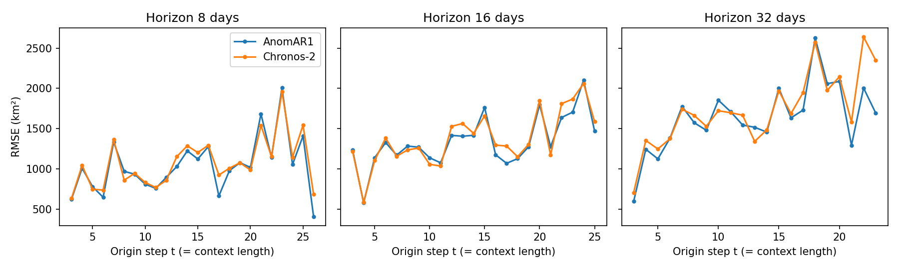

- Trục ngang: gốc t (= độ dài ngữ cảnh Chronos-2 nhìn thấy). Mỗi điểm là RMSE của 11 mùa tại gốc đó.
- Ở 32 ngày, hai đường bám nhau đến t ≈ 20, rồi Chronos-2 vọt lên ở t = 22–23 (đích rơi vào cuối mùa nước rút).
- Bảng `rmse_by_season_part.csv` (**lập sau khi xem hình**, chỉ mô tả): 32 ngày, gốc t ≤ 20: 1.687 (AnomAR1) so với 1.703 (Chronos-2);
  gốc t ≥ 21: 1.689 so với **2.236**. Phần thua chủ yếu nằm ở cuối mùa, do vài mùa (2012, 2014, 2015, 2019) chi phối.
- Ở vài gốc đầu Chronos-2 cũng kém 10–18% (t = 3: 705 so với 597), nhưng sai số đầu mùa nhỏ về km² nên bị che khi gộp.

**Hình 6.19 – Hai mùa ví dụ** (`results/Chronos-2/figures/example_seasons.png`)

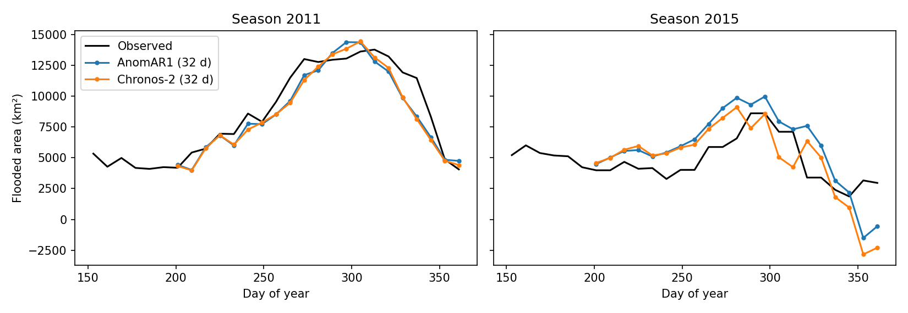

- 2011: hai mô hình gần như trùng nhau. 2015: cuối mùa Chronos-2 đoán **xuống tới −2.800 km²**, sâu hơn AnomAR1.
  Chronos-2 ngoại suy đà giảm của độ lệch quá đà.

**Hình 6.20 – RMSE theo tầm** (`results/Chronos-2/figures/rmse_by_horizon.png`): hai cột AnomAR1/Chronos-2 ở 3 tầm, khoảng cách lớn dần.

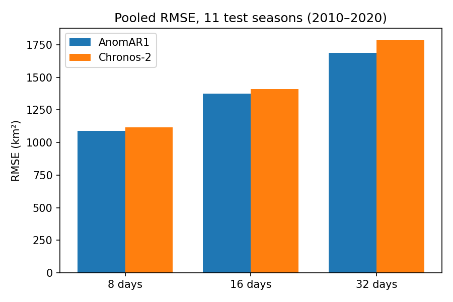

#### Kiểm tra phụ: fine-tune (thăm dò, `finetune_check.csv`)

Học thêm Chronos-2 trên GPU cho từng mùa thi, chỉ từ các mùa trước nó:

| | 8 ngày | 16 ngày | 32 ngày | 32 ngày, t ≤ 20 | 32 ngày, t ≥ 21 |
|---|--:|--:|--:|--:|--:|
| AnomAR1 | 1.090 | 1.375 | 1.687 | 1.687 | 1.689 |
| Zero-shot | 1.116 | 1.412 | 1.788 | 1.703 | 2.236 |
| Fine-tune toàn bộ (50 bước, lr 1e-6) | 1.121 | 1.403 | 1.758 | 1.671 | 2.213 |
| Fine-tune LoRA (50 bước, lr 1e-5) | 1.185 | 1.501 | 1.939 | 1.846 | 2.425 |

- Fine-tune nhẹ gần như không đổi (±2%); LoRA tệ hơn (học thuộc vì chỉ có 7–17 mùa × 27 điểm).
- **Chỉ là thăm dò**: hai cấu hình chọn sau khi đã thử trên mùa 2020 (có nhìn mùa thi), không theo luật 6 cấu hình. Không vào bảng chính.
  Nó cho thấy fine-tune **không đổi kết luận**. Thú vị: trên riêng mùa 2020, LoRA trông tốt nhất ở 8 ngày, trên cả 11 mùa lại tệ nhất:
  ví dụ thật cho lý do **cấm chọn cấu hình bằng mùa thi**.

---

## 7. So sánh chung 4 mô hình

Code: `src/Comparison/comparison_tables.py`, `comparison_figures.py`. Bảng và hình: `results/Comparison/`.
Notebook: `notebooks/Comparison/comparison_overview.ipynb`.

### 7.1 Mọi người dùng chung một mốc

Mỗi thư mục mô hình tự tính lại AnomAR1. `baseline_check.csv` xác nhận cột `anom_ar1` của 4 thư mục có cùng 748 dòng và lệch nhau
tối đa 9 × 10⁻¹³ km² (chỉ là sai số làm tròn máy). Nếu lệch, code dừng và báo lỗi.

### 7.2 Bảng chính (`results/Comparison/tables/vs_anom_ar1_main.csv`, không làm tròn)

**Đây là bảng mà báo cáo và video trích số.**

| Mô hình | Tầm | Tỉ lệ RMSE | Mùa thắng | Chênh MSE % (CI 95%) | p t | p Wilcoxon | p TOST | p Holm (trong mô hình) | **p Holm (họ chính)** |
|---|--:|--:|--:|--:|--:|--:|--:|--:|--:|
| GAM | 8 | 1,006 | 5 | +2,2 (−2,8; +7,2) | 0,508 | 0,765 | **0,002** | 1 | 1 |
| GAM | 16 | 0,997 | 7 | +2,0 (−10,5; +14,5) | 0,914 | 0,638 | 0,053 | 1 | 1 |
| GAM | 32 | 1,001 | 7 | +9,4 (−23,0; +41,8) | 0,990 | 0,700 | 0,253 | 1 | 1 |
| LightGBM | 8 | 0,965 | 5 | −4,9 (−18,7; +8,9) | 0,408 | 0,638 | 0,363 | 1 | 1 |
| LightGBM | 16 | 0,934 | 9 | −5,3 (−27,0; +16,4) | 0,140 | 0,102 | 0,511 | 1 | 1 |
| LightGBM | 32 | 1,001 | 5 | +11,8 (−23,9; +47,5) | 0,989 | 0,898 | 0,293 | 1 | 1 |
| Chronos-2 | 8 | 1,024 | 4 | +7,7 (−1,0; +16,5) | 0,303 | 0,175 | 0,216 | 0,605 | 1 |
| Chronos-2 | 16 | 1,027 | 2 | +7,2 (−2,4; +16,8) | 0,346 | 0,175 | 0,211 | 0,605 | 1 |
| Chronos-2 | 32 | 1,060 | 2 | +14,3 (**+4,0; +24,5**) | 0,005 | 0,010 | 0,748 | 0,015 | **0,045** |

**Đọc bảng:**
- Chỉ có **một** ô có ý nghĩa sau Holm họ chính: Chronos-2 ở 32 ngày, và đó là **kém hơn**.
- Chỉ có **một** bằng chứng "ngang nhau": GAM ở 8 ngày (p TOST = 0,002).
- LightGBM 16 ngày là ứng viên "tốt hơn" mạnh nhất (tỉ lệ 0,934, thắng 9/11), nhưng p = 0,14 trước hiệu chỉnh, 1 sau hiệu chỉnh;
  CI từ −27% đến +16%: vẫn có thể là tốt hơn nhiều, cũng có thể là tệ hơn.

### 7.3 Bảng RMSE gộp mọi mô hình (`rmse_all.csv`)

| Mô hình | Vai trò | 8 ngày | 16 ngày | 32 ngày |
|---|---|--:|--:|--:|
| AnomAR1 | mốc | 1.090 | 1.375 | 1.687 |
| GAM | chính | 1.096 | 1.372 | 1.688 |
| LightGBM thô | chính | 1.051 | 1.284 | 1.688 |
| Chronos-2 | chính | 1.116 | 1.412 | 1.788 |
| AnomAR1 7 mùa | biến thể | 1.084 | 1.355 | 1.682 |
| GAM 7 mùa | biến thể | 1.090 | 1.378 | 1.711 |
| LightGBM anomaly | biến thể | 1.101 | 1.364 | 1.699 |
| LightGBM không climatology | biến thể | 1.059 | 1.301 | 1.778 |
| Clim5 | mốc ngây thơ | 1.812 | 1.845 | 1.916 |
| Persistence | mốc ngây thơ | 1.312 | 2.068 | 3.456 |

### 7.3b Bảng R² gộp (`r2_all.csv`)

| Mô hình | Vai trò | 8 ngày | 16 ngày | 32 ngày |
|---|---|--:|--:|--:|
| AnomAR1 | mốc | 0,868 | 0,795 | 0,704 |
| GAM | chính | 0,866 | 0,796 | 0,704 |
| LightGBM thô | chính | **0,877** | **0,821** | 0,704 |
| Chronos-2 | chính | 0,861 | 0,783 | 0,668 |
| AnomAR1 7 mùa | biến thể | 0,869 | 0,801 | 0,706 |
| GAM 7 mùa | biến thể | 0,868 | 0,794 | 0,696 |
| LightGBM anomaly | biến thể | 0,865 | 0,798 | 0,700 |
| LightGBM không climatology | biến thể | 0,875 | 0,816 | 0,672 |
| Clim5 | mốc ngây thơ | 0,634 | 0,630 | 0,618 |
| Persistence | mốc ngây thơ | 0,808 | 0,536 | −0,241 |

- 4 mô hình chính giải thích khoảng 86–88% biến động ở 8 ngày, 78–82% ở 16 ngày, 67–70% ở 32 ngày.
- Khác biệt giữa các mô hình chính chỉ khoảng 1–4 điểm phần trăm R²; xếp hạng trùng với RMSE (cùng mẫu số).
- Persistence ở 32 ngày có R² âm: đoán "giữ nguyên như hôm nay" còn tệ hơn đoán bằng trung bình.

### 7.4 Hình so sánh

**Hình 7.1 – RMSE theo tầm** (`results/Comparison/figures/rmse_by_horizon.png`)

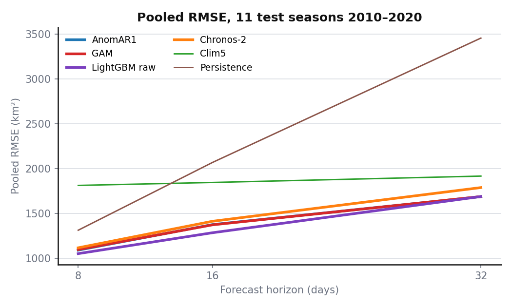

- Mỗi mô hình là một đường liền có màu riêng: AnomAR1 xanh dương, GAM đỏ, LightGBM tím, Chronos-2 cam, Clim5 xanh lá, Persistence nâu
  (4 mô hình chính vẽ nét dày hơn). Cùng bảng màu này dùng cho mọi hình ở mục 7–8.
- 4 mô hình chính nằm sát nhau trong một dải hẹp (đường xanh dương của AnomAR1 gần như bị đường đỏ của GAM che); Persistence tăng vọt; Clim5 gần như phẳng.
- Ở 8 ngày Persistence còn khá (1.312) nhưng từ 16 ngày nó tệ hơn cả Clim5. Mọi mô hình chính đều tốt hơn hai mốc ngây thơ ở mọi tầm.

**Hình 7.2 – Tỉ lệ từng mùa** (`results/Comparison/figures/season_ratio.png`, bảng `season_rmse.csv`)

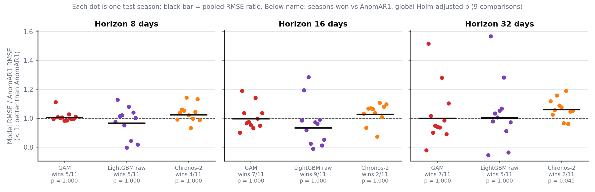

- Mỗi điểm = một mùa thi; vạch đen = tỉ lệ RMSE gộp. Dưới tên: số mùa thắng và p Holm họ chính.
- 8 ngày: GAM dồn sát 1; LightGBM trải từ 0,80 đến 1,13; Chronos-2 hơi trên 1.
- 32 ngày: GAM và LightGBM có vài mùa rất tệ (1,3–1,6) xen vài mùa rất tốt (0,75–0,78): trung bình ≈ 1 nhưng **rủi ro cao**.
  Chronos-2 nằm trên 1 ở 9/11 mùa.

Tỉ lệ từng mùa ở 16 ngày (`season_rmse.csv`):

| Mùa | Cỡ lũ | GAM | LightGBM | Chronos-2 |
|---|---|--:|--:|--:|
| 2010 | lớn | 0,900 | 0,986 | 1,031 |
| 2011 | lớn | 1,189 | 1,193 | 0,934 |
| 2012 | lớn | 1,035 | 0,917 | 1,067 |
| 2013 | lớn | 0,966 | 1,284 | 1,069 |
| 2014 | vừa | 0,974 | 0,824 | 1,064 |
| 2015 | nhỏ | 0,953 | 0,788 | 1,035 |
| 2016 | vừa | 0,931 | 0,972 | 0,872 |
| 2017 | vừa | 1,140 | 0,962 | 1,108 |
| 2018 | nhỏ | 0,997 | 0,990 | 1,008 |
| 2019 | nhỏ | 0,949 | 0,812 | 1,081 |
| 2020 | nhỏ | 1,036 | 0,852 | 1,096 |

(Cỡ lũ: chia 11 mùa thi thành 3 nhóm theo đỉnh. Lớn: 2010–2013. Vừa: 2014, 2016, 2017. Nhỏ: 2015, 2018–2020.
Lưu ý: mùa lũ nhỏ đều là những năm cuối, khi tập học dài nhất, nên "cỡ lũ" lẫn với "lượng dữ liệu học".)

**Hình 7.3 – Hai mùa ví dụ, 4 mô hình** (`results/Comparison/figures/example_seasons.png`)

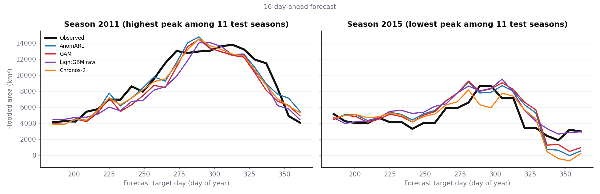

- 2011 (đỉnh cao nhất): mọi mô hình đoán đỉnh **sớm** hơn và rút **sớm** hơn thật (thật kéo dài đến ngày ~340).
- 2015 (đỉnh thấp nhất): ở 16 ngày mọi mô hình đoán cao hơn thật khi nước lên; cuối mùa AnomAR1, GAM, Chronos-2 xuống dưới 0, LightGBM thì không.

---

## 8. Theo điều kiện: khi nào mô hình nào khá hơn

Bảng chuẩn (cùng dạng ở mọi thư mục): `rmse_by_phase.csv` (cột h, model, rising, peak, falling) và `rmse_by_size.csv`
(cột h, model, small, medium, large). Bản gộp 4 mô hình: `results/Comparison/tables/`.

- **Giai đoạn** theo ngày đích: nước lên < ngày 257; đỉnh 257–297; nước rút ≥ 298.
- **Cỡ lũ**: chia 11 mùa thi thành 3 nhóm theo đỉnh.
- **Chỉ để mô tả, không kiểm định** (các nhóm nhỏ, nhiều lát cắt, dễ thấy "khác biệt" do may).

**Theo giai đoạn (RMSE km²):**

| Tầm | Mô hình | Nước lên | Đỉnh | Nước rút |
|---|---|--:|--:|--:|
| 8 | AnomAR1 | 897 | 1.068 | 1.304 |
| 8 | GAM | 886 | 1.096 | 1.311 |
| 8 | LightGBM | **842** | 1.180 | **1.177** |
| 8 | Chronos-2 | 900 | 1.152 | 1.314 |
| 16 | AnomAR1 | 1.154 | **1.391** | 1.578 |
| 16 | GAM | 1.121 | 1.408 | 1.584 |
| 16 | LightGBM | **1.048** | 1.531 | **1.321** |
| 16 | Chronos-2 | 1.134 | 1.468 | 1.633 |
| 32 | AnomAR1 | 1.357 | 1.692 | **1.927** |
| 32 | GAM | 1.251 | 1.708 | 1.981 |
| 32 | LightGBM | **1.225** | 1.742 | 1.973 |
| 32 | Chronos-2 | 1.410 | **1.658** | 2.144 |

**Theo cỡ lũ (RMSE km²):**

| Tầm | Mô hình | Lũ nhỏ | Lũ vừa | Lũ lớn |
|---|---|--:|--:|--:|
| 8 | AnomAR1 | 1.179 | 1.196 | **896** |
| 8 | GAM | 1.175 | **1.194** | 923 |
| 8 | LightGBM | **1.046** | 1.205 | 925 |
| 8 | Chronos-2 | 1.220 | 1.199 | 926 |
| 16 | AnomAR1 | 1.488 | 1.367 | **1.260** |
| 16 | GAM | 1.460 | 1.334 | 1.307 |
| 16 | LightGBM | **1.261** | **1.269** | 1.318 |
| 16 | Chronos-2 | 1.579 | 1.323 | 1.295 |
| 32 | AnomAR1 | 1.885 | **1.400** | **1.675** |
| 32 | GAM | 1.826 | 1.413 | 1.734 |
| 32 | LightGBM | **1.767** | 1.518 | 1.728 |
| 32 | Chronos-2 | 1.972 | 1.479 | 1.807 |

**Hình 8.1** (`results/Comparison/figures/conditions.png`): cùng số liệu dưới dạng cột. Mỗi mô hình một màu (xanh dương, đỏ, tím, cam như Hình 7.1).

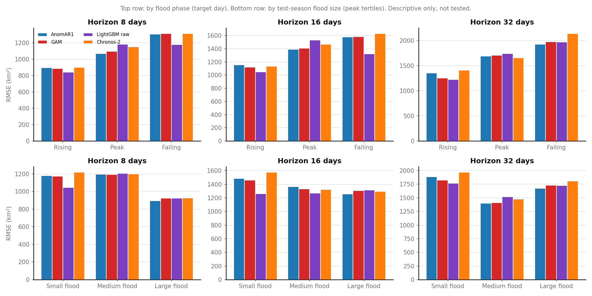

**Đọc được gì:**
- Sai số mọi mô hình tăng dần: nước lên < đỉnh < nước rút. Nước rút khó nhất (đúng với EDA: độ lệch chuẩn lớn nhất).
- LightGBM khá hơn khi nước lên và nước rút ở 8–16 ngày, kém hơn ở đỉnh: cây quyết định "cắt ngọn" các giá trị đỉnh.
- Ở mùa lũ **nhỏ**, LightGBM thấp hơn AnomAR1 11–15% ở 8–16 ngày: đúng nơi mức bình thường (nhớ các năm lũ to) bị lệch nhiều nhất.
- AnomAR1 vẫn tốt nhất ở mùa lũ **lớn**.
- GAM khá hơn AnomAR1 khi nước lên ở 32 ngày (1.251 so với 1.357) nhờ phần sửa lệch theo ngày.

---

## 9. Kết luận, cách nói an toàn, hạn chế

### 9.1 Kết luận

1. Trên 11 mùa thi (2010–2020), **không mô hình nào tốt hơn AnomAR1 có ý nghĩa thống kê** sau hiệu chỉnh Holm cho 9 phép so.
2. **Chronos-2 zero-shot kém hơn AnomAR1 có ý nghĩa ở tầm 32 ngày** (RMSE cao hơn 6%, p Holm = 0,045). Fine-tune thử nghiệm không đổi kết luận.
3. **GAM ngang AnomAR1 ở 8 ngày** trong biên ±5% (TOST p = 0,002). Ở 16 và 32 ngày chưa đủ bằng chứng để nói ngang hay khác.
4. **LightGBM có RMSE thấp nhất ở 8–16 ngày** (−3,5%, −6,6%), ổn định qua 10 seed, nhưng khoảng tin cậy rộng: là tín hiệu đáng kiểm tra trên dữ liệu mới, chưa phải kết luận.
5. Mọi mô hình chính đều tốt hơn hẳn hai mốc ngây thơ (Persistence, Clim5).

### 9.2 Vì sao mô hình phức tạp khó thắng

- Chỉ **21 mùa**, mỗi mùa 27 điểm: rất ít cho máy học và gần như không có gì cho một mô hình lớn học thêm.
- AnomAR1 đã nắm hai điều quan trọng nhất: chu kỳ mùa (qua mức bình thường) và quán tính (qua φ). LightGBM tự học ra đúng hai điều đó (mục 6.4, SHAP).
- **Dữ liệu thay đổi theo thời gian** (đỉnh giảm 314 km²/năm): các mùa thi có lũ nhỏ hơn mọi mùa học. Mô hình nào cũng bị "nhớ" quá khứ to.

### 9.3 Cách nói an toàn

- ✅ "Trên 11 mùa thi, không mô hình nào tốt hơn AnomAR1 có ý nghĩa sau hiệu chỉnh Holm cho 9 phép so; Chronos-2 zero-shot kém hơn có ý nghĩa ở tầm 32 ngày."
- ✅ "LightGBM có RMSE thấp nhất ở 8–16 ngày, nhưng khoảng tin cậy chứa 0."
- ❌ "LightGBM là tốt nhất." (chưa chứng minh)
- ❌ "GAM ngang AnomAR1." (chỉ chứng minh ở 8 ngày)
- ❌ "Foundation model kém." (chỉ một model, một cách đưa ngữ cảnh, một bộ dữ liệu)
- ❌ "Lũ giảm do đê bao / đập." (dữ liệu không cho nói nhân quả, chỉ nói "phù hợp với")

### 9.4 Hạn chế

- n = 11 mùa thi, một chuỗi toàn vùng → lực kiểm định thấp, khoảng tin cậy rộng.
- Mục tiêu là sản phẩm **suy ra** từ ảnh vệ tinh MODIS, có sai số đo; 2 ảnh nội suy, 15 ảnh trùng lặp được giữ lại và gắn cờ.
- Không dùng biến ngoài (mưa, mực nước thượng nguồn, thủy triều) vì bộ dữ liệu không có.
- Một số dự báo âm (không cắt về 0 để giữ giao thức).
- Không dùng SEM (mô hình phương trình cấu trúc): SEM cần nhiều biến quan sát để dựng biến tiềm ẩn và đường dẫn nhân quả
  (ví dụ khảo sát nhiều câu hỏi). Dữ liệu ở đây là **một chuỗi thời gian một biến** (diện tích ngập toàn vùng) và không có biến ngoài,
  nên không có cấu trúc đo lường nào để SEM ước lượng; chỉ số RMSEA vì vậy cũng không áp dụng. Thay vào đó, phần suy luận dùng
  kiểm định cặp cấp mùa (t, Wilcoxon, TOST, Holm) và R²/RMSE để so mô hình.
- Các bảng theo điều kiện, bóc tách GAM, chia gốc t ≤ 20 / ≥ 21 của Chronos-2, fine-tune Chronos-2: lập sau khi xem kết quả → chỉ mô tả.

---

## 10. Code: cấu trúc repo và cách chạy lại

### 10.1 Cấu trúc

```
Group03_STAT3013_R11/
├── app/streamlit_app.py          Báo cáo tương tác (tiếng Anh), đọc bảng chuẩn, không tính lại mô hình
├── .streamlit/config.toml        Giao diện (màu trắng / xanh trời / đen theo video)
├── configs/regions/mekong.yaml   Cấu hình vùng: năm, ngày đầu, bước 8 ngày, 27 bước, 2 ảnh thiếu
├── data/processed/level1_series.csv   Đầu vào chung (567 dòng)
├── docs/                         Tài liệu (file này; ghi chú cũ của phần LightGBM)
├── notebooks/<Model>/            Notebook tổng quan, mỗi cái có bản tiếng Việt và tiếng Anh (_en)
├── results/<Model>/{tables,figures}/   Kết quả mỗi mô hình
├── results/Comparison/           Bảng và hình so sánh chung
├── src/<Model>/                  Code mỗi mô hình, tự chứa (không import chéo thư mục)
├── src/Comparison/               Code so sánh chung
├── tests/<Model>/                Test mỗi mô hình (130 test, tất cả đều qua)
├── requirements.txt              Thư viện, đã ghim phiên bản
└── README.md                     Hướng dẫn ngắn
```

`<Model>` ∈ {AnomAR1, GAM, LightGBM, Chronos-2}. **Mỗi mô hình tự chứa**: code, test, kết quả, notebook riêng; tên file có tiền tố
(`anomar1_`, `gam_`, `lightgbm_`, `chronos2_`, `comparison_`), có test kiểm tra quy ước này.

### 10.2 Năm bảng chuẩn (mọi mô hình đều ghi, cùng cột)

| File | Cột |
|---|---|
| `predictions.csv` | `season, t, doy_target, y_target, model, h, pred` – mỗi dòng một dự báo |
| `rmse.csv` | `model, 1, 2, 4` – RMSE gộp theo tầm |
| `vs_anom_ar1.csv` | `model, h, n_seasons, rmse_ratio, wins, mse_diff_pct, mse_diff_pct_ci_low, mse_diff_pct_ci_high, p_t, p_wilcoxon, p_tost, p_t_holm` |
| `rmse_by_phase.csv` | `h, model, rising, peak, falling` |
| `rmse_by_size.csv` | `h, model, small, medium, large` |

### 10.3 Chạy lại từ đầu (PowerShell, từ thư mục gốc)

```powershell
py -3.12 -m venv .venv
.\.venv\Scripts\Activate.ps1
python -m pip install -r requirements.txt

# AnomAR1
python src/AnomAR1/anomar1_forecast.py
python src/AnomAR1/anomar1_evaluate.py
python src/AnomAR1/anomar1_diagnostics.py
python src/AnomAR1/anomar1_eda.py
# GAM (bước 2 mất khoảng 2–4 phút)
python src/GAM/gam_build_dataset.py
python src/GAM/gam_run_model.py
python src/GAM/gam_analysis.py
python src/GAM/gam_figures.py
# LightGBM (diag 10 seed khoảng 1 phút)
python src/LightGBM/lightgbm_forecast.py
python src/LightGBM/lightgbm_evaluate.py
python src/LightGBM/lightgbm_diag.py
python src/LightGBM/lightgbm_diag.py extras
python src/LightGBM/lightgbm_diag.py seasons
# Chronos-2 (lần đầu tải trọng số từ Hugging Face; fine-tune cần GPU)
python src/Chronos-2/chronos2_forecast.py
python src/Chronos-2/chronos2_evaluate.py
python src/Chronos-2/chronos2_finetune_check.py
# So sánh chung (sau khi 4 mô hình đã ghi predictions.csv)
python src/Comparison/comparison_tables.py
python src/Comparison/comparison_figures.py

# Kiểm thử và báo cáo tương tác
python -m pytest
python -m streamlit run app/streamlit_app.py
```

### 10.4 Test kiểm tra gì

- Luật chơi: đúng 11 fold, đúng mùa học, không rò rỉ tương lai (thay tương lai bằng 10⁹, dự báo không đổi).
- Công thức: AnomAR1, φ, Holm, TOST, RMSE khớp đáp án tính tay; φ khớp statsmodels.
- Định dạng: 5 bảng chuẩn đúng cột; tên file đúng tiền tố.
- So sánh chung: số trong `results/Comparison/` khớp bảng của từng mô hình; cột `anom_ar1` khớp giữa 4 thư mục (lệch là dừng);
  họ chính đúng 9 dòng; tính tay Chronos-2 32 ngày = 9 × p = 0,0453.
- Chronos-2 dùng pipeline giả trong test nên không cần tải model.

### 10.5 Báo cáo tương tác (Streamlit)

6 tab: **Summary** (câu trả lời ngắn, 3 thẻ tỉ lệ ở 16 ngày), **Data** (chuỗi từng mùa), **Errors** (RMSE),
**Significance** (CI 95%, bảng kiểm định, p Holm họ chính), **When models differ** (theo giai đoạn / cỡ lũ),
**Season by season** (vẽ dự báo từng mùa, chọn mô hình và tầm).

---

## 11. Danh mục mọi bảng và hình

### `results/AnomAR1/`

| File | Nội dung |
|---|---|
| tables/predictions.csv | 4 mô hình (anom_ar1, anom_ar1_w7, clim5, persistence) × 748 dự báo |
| tables/rmse.csv, vs_anom_ar1.csv, rmse_by_phase.csv, rmse_by_size.csv | bảng chuẩn |
| tables/phi_by_fold.csv | φ, sai số chuẩn, φ^h cho mỗi fold × tầm |
| tables/regression_rows.csv | các cặp (a_{t−1}, a_t) dùng để ước lượng φ |
| tables/phi_direct_sensitivity.csv | φ^h so với φ ước lượng trực tiếp theo tầm |
| tables/residual_tests.csv, residual_summary.csv | thiên lệch, ACF, Ljung–Box của phần dư |
| tables/eda_descriptive.csv, eda_inference.csv | thống kê mô tả, kiểm định xu hướng đỉnh |
| tables/trace_1602.csv | truy vết số cũ 1.602 (lịch sử) |
| figures/seasons_overlay, heatmap_season_step, peak_trend, distribution_boxplots | EDA (mục 2.3) |
| figures/phi_by_fold, typical_seasons, residual_diagnostics | AnomAR1 (mục 6.2) |

### `results/GAM/`

| File | Nội dung |
|---|---|
| tables/predictions.csv | gam, gam_w7, anom_ar1, anom_ar1_w7, clim5, persistence |
| tables/rmse.csv, vs_anom_ar1.csv, rmse_by_phase.csv, rmse_by_size.csv | bảng chuẩn |
| tables/gam_w7_vs_anom_ar1_w7.csv | bản 7 mùa so với AnomAR1 7 mùa |
| tables/gam_chosen_configs.csv | cấu hình chọn và MSE validation của cả 6 cấu hình |
| tables/gam_coefficients.csv, gam_seasonal_curve.csv | hệ số β, đường cong s(ngày) |
| tables/gam_season_rmse.csv | RMSE, thiên lệch từng mùa |
| tables/climatology_bias.csv | mức bình thường lệch bao nhiêu theo khoảng ngày |
| tables/gam_residual_tests.csv, gam_residual_summary.csv | chẩn đoán phần dư |
| tables/gam_ablation_predictions.csv, gam_ablation_rmse.csv | bóc tách (phụ) |
| figures/fig01–fig12 | mục 2.3, 4.1, 6.3 |

### `results/LightGBM/`

| File | Nội dung |
|---|---|
| tables/predictions.csv | lgbm_raw, lgbm_anomaly, lgbm_noclim, anom_ar1, clim5 |
| tables/rmse.csv, vs_anom_ar1.csv, rmse_by_phase.csv, rmse_by_size.csv | bảng chuẩn |
| tables/lightgbm_chosen_configs.csv | cấu hình chọn, 10 seed |
| tables/lightgbm_seed_predictions.csv, lightgbm_seed_summary.csv | ổn định theo seed |
| tables/lightgbm_feature_importance.csv | gain, SHAP |
| tables/lightgbm_permutation_importance.csv, lightgbm_permutation_summary.csv | permutation importance |
| tables/lightgbm_season_rmse.csv, lightgbm_phase_by_season_h2.csv | theo mùa, theo giai đoạn × mùa |
| tables/lightgbm_vs_rf_fixed_configs_h2.csv | so với Random Forest |
| figures/seed_rmse, shap_h2, phase_ratio_by_season_h2, season_examples | mục 6.4 |

### `results/Chronos-2/`

| File | Nội dung |
|---|---|
| tables/predictions.csv | chronos2, anom_ar1 |
| tables/rmse.csv, vs_anom_ar1.csv, rmse_by_phase.csv, rmse_by_size.csv | bảng chuẩn |
| tables/rmse_by_origin.csv, rmse_by_season_part.csv | theo gốc t; t ≤ 20 / t ≥ 21 |
| tables/finetune_check.csv, finetune_check_predictions.csv | fine-tune thăm dò |
| figures/rmse_by_horizon, rmse_by_origin, example_seasons | mục 6.5 |

### `results/Comparison/`

| File | Nội dung |
|---|---|
| tables/vs_anom_ar1_main.csv | **bảng chính**: họ chính 9 phép, không làm tròn |
| tables/vs_anom_ar1_all.csv | mọi mô hình so với AnomAR1 (làm tròn), có `p_t_holm_main` cho bản chính |
| tables/rmse_all.csv | RMSE mọi mô hình, kèm thư mục nguồn và vai trò |
| tables/r2_all.csv | R² gộp mọi mô hình (cùng dạng rmse_all) |
| tables/rmse_by_phase.csv, rmse_by_size.csv | 4 bản chính × 3 tầm |
| tables/season_rmse.csv | RMSE từng mùa và tỉ lệ so với AnomAR1 |
| tables/baseline_check.csv | kiểm tra mốc chung |
| figures/rmse_by_horizon, season_ratio, conditions, example_seasons | mục 7–8 |

---

## 12. Câu hỏi vấn đáp thường gặp

**Vì sao chọn AnomAR1 làm mốc mà không phải Persistence?**
Persistence quá yếu ở tầm xa (3.456 km² ở 32 ngày), thắng nó không chứng minh gì. AnomAR1 là mốc thống kê mạnh, đơn giản, giải thích được.

**Vì sao mức bình thường là trung bình 5 năm trước, không phải mọi năm trước?**
Vì lũ giảm dần theo thời gian (−314 km²/năm). Lấy mọi năm thì mức bình thường bị kéo lên bởi các năm 2000 lũ to.

**Vì sao chỉ dùng 11 mùa để thi?**
Cần ít nhất 3 mùa để tính mức bình thường (2000–2002) và đủ mùa để học (từ 2003). Thi từ 2010 để mỗi fold có ít nhất 7 mùa học.

**Kiểm định theo mùa thì chỉ có n = 11, có quá ít không?**
Ít, nên lực kiểm định thấp và nhóm nói rõ "không khác có ý nghĩa" ≠ "ngang nhau". Nhưng dùng 748 dự báo như độc lập thì sai,
vì sai số trong mùa tương quan mạnh (ACF độ trễ 1 tới 0,48).

**Sao không cắt dự báo âm về 0?**
Cắt về 0 chỉ giúp những mô hình hay đoán âm (AnomAR1, Chronos-2, GAM), làm lệch so sánh. Giao thức chung giữ nguyên dự báo.

**LightGBM thắng 9/11 mùa ở 16 ngày mà sao không có ý nghĩa?**
Thắng nhiều mùa nhưng mức thắng nhỏ, còn vài mùa thua rất nặng (2013: tỉ lệ 1,28; 2011: 1,19). t-test nhìn cả độ lớn, không chỉ đếm thắng.
Wilcoxon (chỉ dùng thứ hạng) cũng chỉ cho p = 0,10. Sau Holm cho 9 phép so thì p = 1.

**Holm có quá khắt khe không?**
Holm là cách hiệu chỉnh tiêu chuẩn và ít khắt khe hơn Bonferroni. Không hiệu chỉnh thì cũng chỉ Chronos-2 32 ngày có p < 0,05
(p thô 0,005); LightGBM 16 ngày vẫn là 0,14. Kết luận không phụ thuộc vào việc có hiệu chỉnh hay không.

**Họ chính có bị chọn sau khi xem kết quả không?**
Không. Bản chính của mỗi thành viên (gam, lgbm_raw, chronos2) được khai báo trước khi chạy test; họ = 3 bản chính × 3 tầm, cố định.

**Chronos-2 zero-shot nghĩa là gì?**
Không học thêm gì từ ĐBSCL. Dữ liệu chỉ dùng để tính mức bình thường và làm ngữ cảnh đầu vào.

**Vì sao Chronos-2 kém ở cuối mùa?**
Cuối mùa nước rút nhanh, độ lệch có đà giảm mạnh; Chronos-2 nối tiếp đà đó quá đà (đoán tới −2.800 km² ở 2015).
Đây là mô tả từ hình, chưa đủ để khẳng định nguyên nhân.

**Có rò rỉ dữ liệu tương lai không?**
Không: mức bình thường chỉ dùng mùa trước, tại gốc t chỉ biết bước 1..t, chọn cấu hình chỉ dùng mùa học. Có test cố ý gài giá trị 10⁹ vào tương lai.

**Muốn thêm mô hình mới thì làm sao?**
Tạo `src/<Tên>/`, `tests/<Tên>/`, ghi 5 bảng chuẩn (đặc biệt `predictions.csv` 7 cột, có cột `anom_ar1`) vào `results/<Tên>/tables/`,
thêm thư mục vào `SOURCES` trong `src/Comparison/comparison_tables.py`. Nếu muốn vào họ chính thì phải khai báo **trước khi** chạy test
và họ sẽ thành 12 phép so.
