# Báo cáo mô hình GAM – Dự báo diện tích ngập ĐBSCL

> Phần B của [reports/members/binh_gam.md](../../../reports/members/binh_gam.md). Mọi con số lấy từ
> `src/GAM/result/tables/` (tên file ghi ở từng mục), do code trong `src/GAM/process/` sinh ra.
> Cách chạy lại và đọc code: [README.md](README.md).
>
> **Đã kiểm tra:** dự báo GAM ở đây trùng với dự báo chung của nhóm, lệch tối đa 6,3e-10 km²
> (`reproduction_check.csv`). Bảng kiểm định trùng `results/tables/probe_vs_anom_ar1.csv`.

---

## Tóm tắt

- GAM dự báo tốt ngang AnomAR1 (mốc thống kê của nhóm): RMSE **1.096 / 1.372 / 1.688 km²** so với 1.090 / 1.375 / 1.687 km² ở 8 / 16 / 32 ngày.
- Ở 8 ngày, có bằng chứng **tương đương** AnomAR1 trong biên ±5% RMSE (TOST p = 0,002, chưa hiệu chỉnh đa kiểm định). Ở 16 và 32 ngày chưa đủ bằng chứng để nói tương đương hay khác biệt.
- Bên trong, GAM gần như là **AR(1) trên anomaly**: hệ số của anomaly hôm nay xấp xỉ φ^h của AnomAR1, còn hệ số của anomaly 8 ngày trước gần 0.
- Phần GAM học thêm là một **đường sửa lệch theo ngày**. Mức bình thường (trung bình 5 mùa trước) cao hơn thực tế khoảng 900–1.000 km² trong mùa lũ, phù hợp với xu hướng đỉnh lũ giảm khoảng 314 km²/năm. Hàm trơn s(ngày) học được phần lệch này.
- Phân tích bóc tách (làm sau khi xem test, chỉ để hiểu mô hình) gợi ý phần phi tuyến không giúp gì thêm: một hồi quy tuyến tính chỉ gồm hệ số chặn và a_t cho RMSE thấp hơn GAM 1–3% ở cả ba tầm.

---

## B1. Mô hình là gì

### Ý tưởng

GAM (Generalized Additive Model, mô hình cộng tính tổng quát) là hồi quy mà **mỗi biến có một hàm riêng**,
rồi cộng các hàm lại. Mỗi hàm có thể là đường thẳng (như hồi quy tuyến tính) hoặc đường cong trơn
do dữ liệu tự quyết định hình dạng.

### Mô hình trong đồ án

Bước 1: tách chu kỳ mùa ra khỏi dữ liệu.

- **Mức bình thường** `c` = trung bình diện tích ngập của 5 mùa liền trước, ở cùng bước trong mùa.
- **Anomaly** `a = y − c`: hôm nay ngập nhiều hơn (a > 0) hay ít hơn (a < 0) bình thường.

Bước 2: GAM dự báo anomaly ở bước đích (sau h bước, 1 bước = 8 ngày):

$$a_{t+h} = \beta_0 + s(\text{ngày đích}) + \beta_1\,a_t + \beta_2\,a_{t-1} + \varepsilon$$

- `s(·)`: hàm trơn (spline có phạt độ cong) của ngày trong năm. Đây là phần "G" của GAM.
- `β1`, `β2`: hệ số tuyến tính của anomaly hôm nay và 8 ngày trước.

Bước 3: dự báo diện tích = `c(ngày đích) + anomaly dự báo`.

### Một ví dụ cụ thể

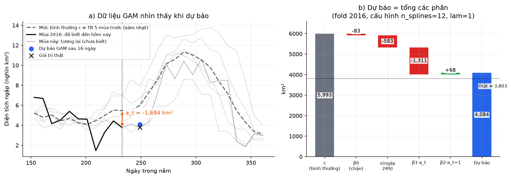

*Hình 3. Mùa 2016, đứng ở ngày 233, dự báo ngày 249 (16 ngày sau). Fold 2016 học trên 2003–2015 và chọn cấu hình n_splines = 12, lam = 1.*

- **Khung a:** mùa 2016 đang thấp hơn mức bình thường 1.694 km² (mũi tên cam). Năm đường xám nhạt là 5 mùa trước dùng để tính mức bình thường.
- **Khung b:** đọc từ trái sang phải.
  - Bắt đầu từ mức bình thường ở ngày 249 là 5.993 km².
  - β0 + s(249) kéo xuống 666 km². Đây là phần sửa lệch theo ngày (mục B5).
  - β1·a_t kéo xuống thêm 1.311 km². Mùa này đang thấp, và GAM dự báo phần thấp đó còn giữ khoảng 77%.
  - β2·a_{t−1} cộng lại 68 km².
  - Kết quả là **4.084 km²**, trong khi giá trị thật là 3.803 km².

---

## B2. Vì sao chọn GAM và GAM thuộc họ nào

- **Họ thống kê.** GAM là hồi quy có giả định rõ ràng (nhiễu chuẩn, các thành phần cộng tính). Mỗi thành phần đọc và vẽ được, có khoảng tin cậy và bậc tự do hiệu dụng. Độ linh hoạt nằm ở hàm trơn, nhưng độ cong bị phạt nên mô hình không tự do như cây quyết định hay mạng nơ-ron.
- **Vì sao dùng spline cho ngày:** ảnh hưởng của mùa vụ không phải đường thẳng (lũ lên, đỉnh, rút). Spline để dữ liệu tự quyết định hình dạng mà không phải đoán trước.
- **Vì sao để trễ tuyến tính:** AnomAR1 cho thấy anomaly suy giảm gần như tuyến tính theo thời gian (hệ số φ). Giữ trễ tuyến tính giúp so sánh trực tiếp β1 với φ^h, và tránh thêm tham số khi chỉ có 11–17 mùa học.
- **Giả định:** (1) các thành phần cộng tính; (2) phần dư độc lập, phương sai đều, phân phối chuẩn. Giả định (2) chỉ cần cho khoảng tin cậy của hệ số, không cần cho dự báo điểm. Mục B5 kiểm tra từng giả định.

---

## B3. Cài đặt trong repo

| Thành phần | Nơi |
|---|---|
| Mô hình chung của nhóm (dùng trong bảng so sánh) | `src/floodbench/models/stat.py`, hàm `gam` |
| Bản viết lại dễ đọc (cho kết quả trùng khớp) | `src/GAM/process/gam_model.py` |
| Chọn cấu hình | `src/floodbench/models/tuning.py`, `pick_config` |
| Đặc trưng | `src/floodbench/features.py`, `build_rows` |

### Giao thức (giống mọi mô hình của nhóm)

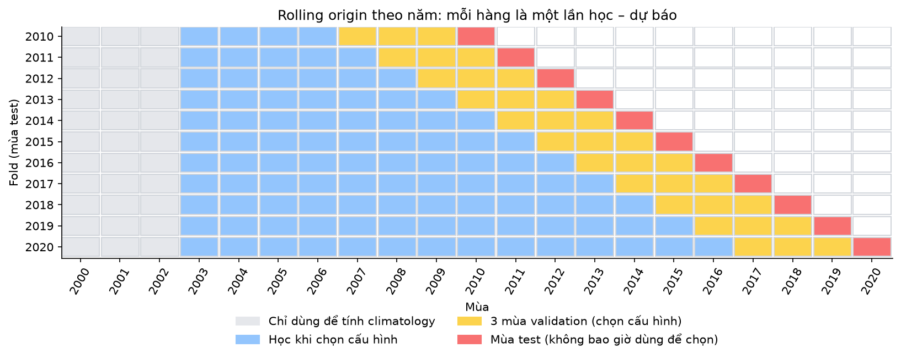

*Hình 2. Mỗi hàng là một fold. Mùa test (đỏ) không bao giờ được dùng để học hay chọn cấu hình. Ba mùa vàng là validation để chọn cấu hình. Mùa 2000–2002 (xám) chỉ dùng để tính mức bình thường.*

- 11 mùa test (2010–2020), 3 tầm (8, 16, 32 ngày). Cấu hình được chọn lại ở **mỗi fold và mỗi tầm**, tổng cộng 33 lần.
- **Lưới 6 cấu hình** (n_splines; lam): (6; 0,1), (6; 1), (8; 0,6), (8; 5), (12; 1), (12; 10). Ngân sách bằng các mô hình khác, đã ghi ở `docs/tuning_log.md`.
  - `n_splines`: số hàm cơ sở, tức độ uốn lượn tối đa của đường cong.
  - `lam`: hệ số phạt độ cong; lam lớn thì đường cong phẳng hơn.
- Bản `_w7`: chỉ học 7 mùa gần nhất, để xem mô hình cần bao nhiêu dữ liệu.

### Cấu hình được chọn

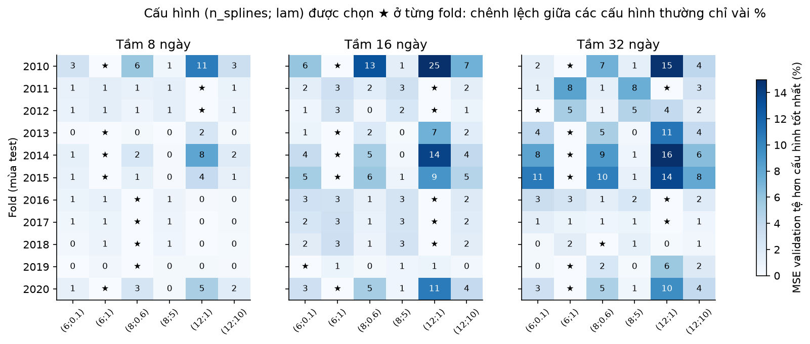

*Hình 4. Ô ★ là cấu hình được chọn. Số trong ô là MSE validation tệ hơn cấu hình tốt nhất bao nhiêu phần trăm. Nguồn: `gam_chosen_configs.csv`.*

- (6; 1) được chọn 16/33 lần, (12; 1) 10 lần, (8; 0,6) 5 lần, (6; 0,1) 2 lần. Hai cấu hình phạt mạnh (8; 5) và (12; 10) chưa lần nào được chọn.
- Chênh lệch giữa cấu hình tốt nhất và tệ nhất có **trung vị chỉ 3,7%** (lớn nhất 24,6% ở fold 2010, tầm 16 ngày). Từ fold 2016 trở đi gần như mọi cấu hình đều trong vòng 3%.
- **Diễn giải:** với 3 mùa validation, việc chọn cấu hình gần như là chọn ngẫu nhiên giữa các phương án ngang nhau. Kết quả GAM vì vậy không phụ thuộc nhiều vào lưới.

---

## B4. Kết quả

### B4.1 RMSE tổng thể

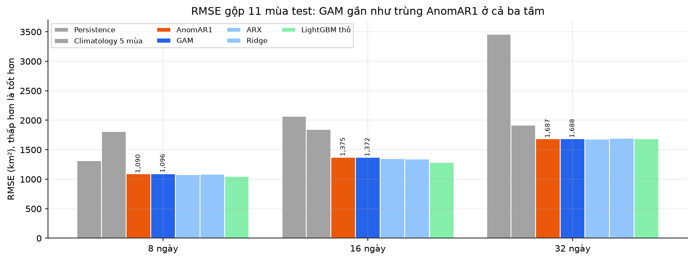

*Hình 7. RMSE gộp mọi dự báo của 11 mùa test. Nguồn: `gam_rmse.csv` (các mô hình khác lấy từ bảng chung).*

| Mô hình | 8 ngày | 16 ngày | 32 ngày |
|---|---|---|---|
| **GAM** | **1.096** | **1.372** | **1.688** |
| AnomAR1 (mốc) | 1.090 | 1.375 | 1.687 |
| ARX | 1.082 | 1.354 | 1.680 |
| Ridge | 1.087 | 1.346 | 1.693 |
| LightGBM thô | 1.051 | 1.284 | 1.688 |
| Climatology 5 mùa | 1.812 | 1.845 | 1.916 |
| Persistence | 1.312 | 2.068 | 3.456 |

- GAM tốt hơn hẳn hai baseline đơn giản: thấp hơn climatology 40% ở 8 ngày, nhưng chỉ 12% ở 32 ngày.
- So với AnomAR1, chênh lệch dưới 1%.

### B4.2 So với AnomAR1 ở cấp mùa

Đơn vị kiểm định là **mùa** (n = 11), không phải từng bước, vì các bước liền nhau tự tương quan mạnh.

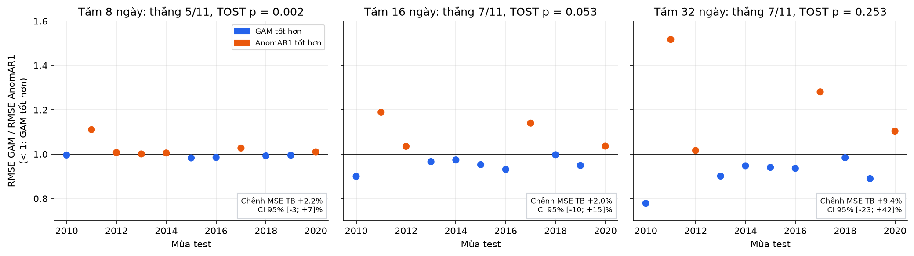

*Hình 8. Mỗi chấm là một mùa test. Dưới đường 1 nghĩa là GAM tốt hơn. Nguồn: `gam_season_rmse.csv`, `gam_vs_anom_ar1.csv`.*

| Tầm | Tỉ lệ RMSE | Mùa thắng | Chênh MSE TB [CI 95%] | p (t) | p (Holm) | p TOST ±5% |
|---|---|---|---|---|---|---|
| 8 ngày | 1,006 | 5/11 | +2,2% [−2,8; +7,2] | 0,51 | 1,00 | **0,002** |
| 16 ngày | 0,997 | 7/11 | +2,0% [−10,5; +14,5] | 0,91 | 1,00 | 0,053 |
| 32 ngày | 1,001 | 7/11 | +9,4% [−23,0; +41,8] | 0,99 | 1,00 | 0,253 |

**Cách đọc:**
- **Tỉ lệ RMSE** gộp mọi dòng. **Chênh MSE TB** là trung bình của chênh lệch phần trăm theo từng mùa. Hai cột có thể ngược dấu: ở 16 ngày tỉ lệ < 1 nhưng chênh MSE TB > 0, vì vài mùa GAM tệ hơn nhiều (2011, 2017) kéo trung bình phần trăm lên.
- **p Holm** được hiệu chỉnh trong cùng họ 42 phép so sánh với bảng chung (14 mô hình × 3 tầm).
- **TOST** kiểm tra có tương đương không: H0 là "chênh lệch RMSE vượt ±5%". p nhỏ nghĩa là có bằng chứng tương đương. p TOST chưa hiệu chỉnh đa kiểm định.

**Kết luận an toàn:**
- 8 ngày: GAM và AnomAR1 **tương đương** trong biên ±5%.
- 16 và 32 ngày: **chưa phân biệt được**. Khoảng tin cậy rộng, nên không nói được là tương đương hay khác nhau.

### B4.3 Theo giai đoạn lũ và cỡ lũ

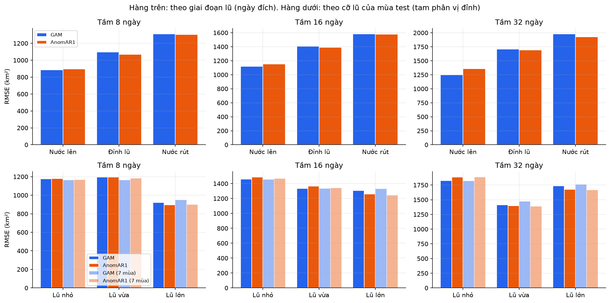

*Hình 9. Nguồn: `gam_by_phase.csv`, `gam_by_magnitude.csv`. Giai đoạn theo ngày đích: nước lên < 257, đỉnh 257–297, nước rút ≥ 298. Cỡ lũ chia theo tam phân vị đỉnh của 11 mùa test: lớn = 2010–2013; vừa = 2014, 2016, 2017; nhỏ = 2015, 2018–2020.*

| RMSE (km²) | Nước lên | Đỉnh | Nước rút |
|---|---|---|---|
| GAM 16 ngày | 1.121 | 1.408 | 1.584 |
| AnomAR1 16 ngày | 1.154 | 1.391 | 1.578 |
| GAM 32 ngày | **1.251** | 1.708 | 1.981 |
| AnomAR1 32 ngày | 1.357 | 1.692 | 1.927 |

- GAM tốt hơn khi **nước lên**, rõ nhất ở 32 ngày (−8%), nhưng kém hơn một chút ở đỉnh và khi nước rút. Điều này phù hợp với hình dạng của s(ngày): đường sửa lệch thay đổi nhanh nhất ở đầu mùa (Hình 6).
- Theo cỡ lũ ở 16 ngày: GAM tốt hơn ở mùa lũ nhỏ và vừa (1.460 so với 1.488; 1.334 so với 1.367) nhưng kém hơn ở mùa lũ lớn (1.307 so với 1.260). Phần kém ở lũ lớn chủ yếu do mùa 2011 (mục B5.4).
- **Lưu ý:** mùa lũ lớn đều là những năm đầu (ít mùa học hơn), nên cỡ lũ và lượng dữ liệu học bị lẫn nhau, giống nhận xét chung của nhóm.

### B4.4 Khi chỉ có 7 mùa học

| RMSE (km²) | 8 ngày | 16 ngày | 32 ngày |
|---|---|---|---|
| GAM (đủ mùa) | 1.096 | 1.372 | 1.688 |
| GAM (7 mùa) | 1.090 | 1.378 | 1.711 |
| AnomAR1 (7 mùa) | 1.084 | 1.355 | 1.682 |
| LightGBM thô (đủ mùa → 7 mùa, bảng chung) | 1.051 → 1.100 | 1.284 → 1.446 | 1.688 → 1.829 |

- GAM gần như **không đổi** khi bớt dữ liệu. Phần chính của nó chỉ có vài hệ số tuyến tính, còn hàm trơn thì bị phạt.
- Ngược lại, LightGBM mất 13% ở 16 ngày.
- Với 7 mùa, việc chọn cấu hình nhiễu hơn (trung vị chênh lệch validation 8,4% so với 3,7%), và GAM_w7 hơi kém AnomAR1_w7 (tỉ lệ 1,006 / 1,017 / 1,017; TOST ±5% chỉ đạt ở 8 ngày, p = 0,013).

---

## B5. Chẩn đoán: GAM học được gì

### B5.1 Hệ số trễ: GAM tự học lại AnomAR1

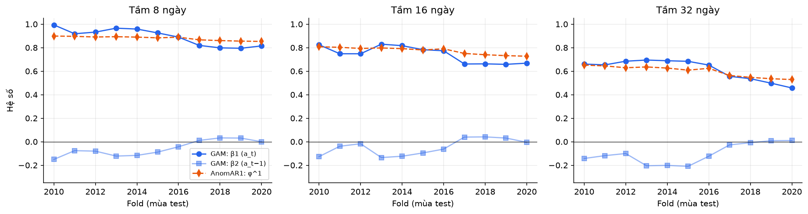

*Hình 5. β1, β2 của GAM ở từng fold so với φ^h của AnomAR1. Nguồn: `gam_coefficients.csv`.*

| Tầm | β1 (a_t), TB [min; max] | β2 (a_{t−1}), TB | φ^h của AnomAR1 (khoảng) |
|---|---|---|---|
| 8 ngày | 0,89 [0,80; 0,99] | −0,06 | 0,85–0,90 |
| 16 ngày | 0,74 [0,66; 0,83] | −0,05 | 0,73–0,81 |
| 32 ngày | 0,62 [0,46; 0,70] | −0,10 | 0,53–0,65 |

- **β1 ≈ φ^h.** Dù không bị ép, GAM học lại đúng tốc độ phai của anomaly mà AnomAR1 giả định.
- **β2 ≈ 0.** Anomaly 8 ngày trước gần như không thêm thông tin, nên quá trình gần với AR(1).
- β1 **giảm bậc từ fold 2017** (16 ngày: khoảng 0,78 xuống 0,66), đúng lúc mùa 2016 vào tập học. Theo `docs/decisions.md`, mùa 2016 có 5/27 ảnh nghi là bản sao. Nguyên nhân chưa kiểm chứng; đây là gợi ý cho phân tích độ nhạy.

### B5.2 Hàm trơn s(ngày): sửa lệch của mức bình thường

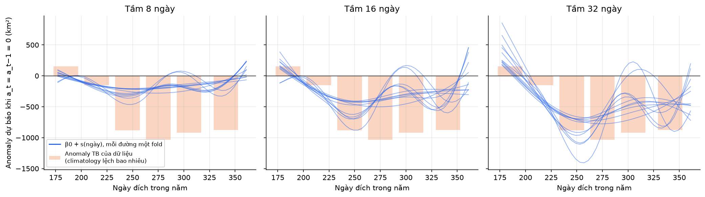

*Hình 6. Đường xanh: β0 + s(ngày) của từng fold, tức anomaly GAM dự báo khi hôm nay đúng bằng mức bình thường. Cột cam: anomaly trung bình thực tế theo ngày. Nguồn: `gam_seasonal_curve.csv`, `climatology_bias.csv`.*

| Ngày đích | 171–200 | 201–230 | 231–260 | 261–290 | 291–320 | 321–361 |
|---|---|---|---|---|---|---|
| Anomaly TB (km²) | +155 | −149 | **−880** | **−1.034** | **−919** | **−877** |

- Nếu mức bình thường không lệch, các cột cam phải quanh 0. Thực tế, từ ngày 230 trở đi **mức bình thường cao hơn thực tế khoảng 900–1.000 km²**.
- Điều này phù hợp với xu hướng đỉnh lũ giảm 314 km²/năm (Hình 1b). Trung bình 5 mùa trước luôn "chậm" khoảng 3 năm so với hiện tại, nên luôn hơi cao.
- GAM học được đường sửa lệch này: đường xanh trũng xuống ở ngày 225–330.
  - Đường xanh nông hơn cột cam vì một phần lệch đã được β1·a_t gánh: khi mùa đang thấp hơn bình thường thì a_t cũng âm.
  - Bậc tự do hiệu dụng của hàm trơn là 2,3–6,3, tức đường cong khá đơn giản.
- **AnomAR1 không có thành phần này** (hồi quy qua gốc, không hệ số chặn). Nó vì vậy dự báo cao hơn thực tế, với thiên lệch −84 / −130 / −302 km² ở ba tầm. GAM chỉ còn +34 / +67 / +105 km².

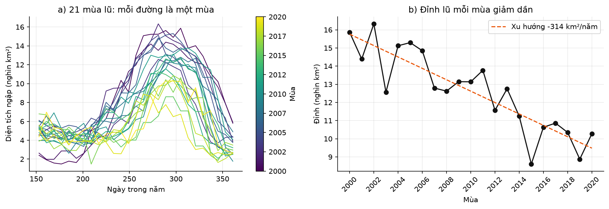

*Hình 1. a) 21 mùa lũ: các mùa gần đây (vàng) thấp hơn các mùa đầu (tím). b) Đỉnh lũ giảm khoảng 314 km²/năm.*

### B5.3 Phần dư

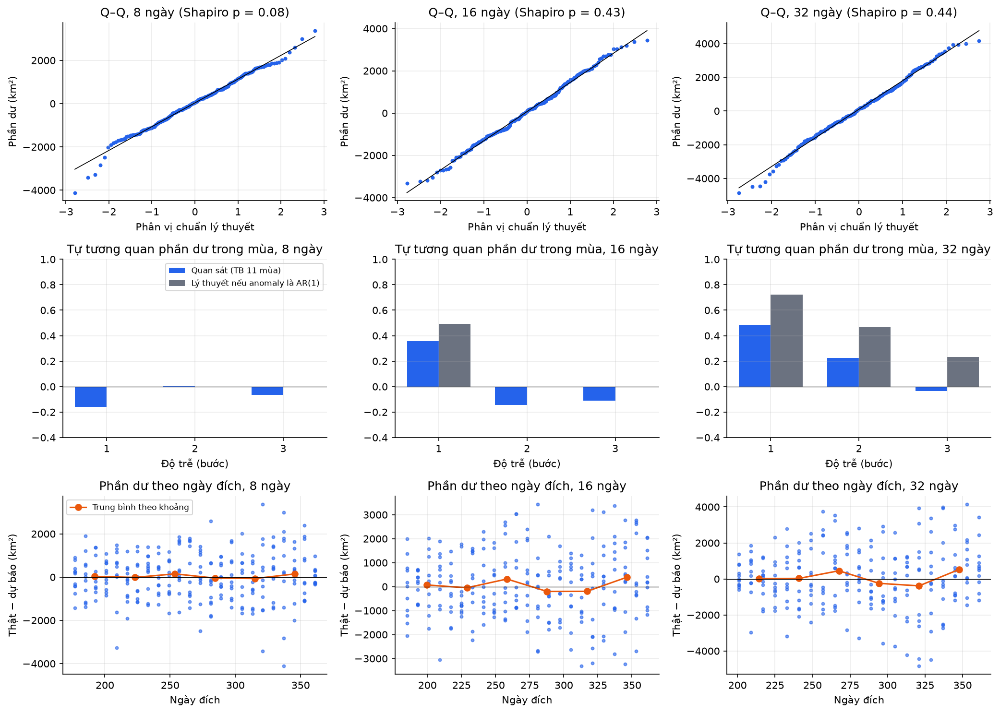

*Hình 10. Nguồn: `gam_residual_summary.csv`, `gam_residual_tests.csv`.*

| Tầm | Thiên lệch | Shapiro p | ACF lag 1 (quan sát / lý thuyết) | Mùa có Ljung–Box p < 0,05 |
|---|---|---|---|---|
| 8 ngày | +34 km² | 0,08 | −0,16 / 0 | 0/11 |
| 16 ngày | +67 km² | 0,43 | 0,36 / 0,49 | 4/11 |
| 32 ngày | +105 km² | 0,44 | 0,48 / 0,72 | 8/11 |

- **Phân phối chuẩn:** đạt. Q–Q gần thẳng, Shapiro không bác bỏ.
- **Phương sai đều:** đạt gần đúng. Phần dư không lớn dần theo độ lớn dự báo (tương quan −0,06), chỉ rộng hơn một chút cuối mùa.
- **Độc lập:** không đạt ở 16 và 32 ngày, nhưng **đây là điều tất yếu, không phải lỗi mô hình**.
  - Khi dự báo trước h bước, hai dự báo liền nhau chung h−1 "cú sốc" chưa biết, nên sai số tự tương quan.
  - Cột xám là mức lý thuyết nếu anomaly đúng là AR(1). Ví dụ ở 16 ngày: φ/(1+φ²) ≈ 0,49.
  - ACF quan sát thấp hơn lý thuyết một chút, vì ACF tính trong từng mùa ngắn (21–24 điểm) bị chệch về 0.
  - Hệ quả thực tế: không được coi từng bước là quan sát độc lập. Nhóm đã kiểm định ở cấp mùa vì lý do này.
- Ở 8 ngày, phần dư gần như không tự tương quan, tức mô hình đã lấy hết cấu trúc tuyến tính ngắn hạn.

### B5.4 Hai mùa tiêu biểu

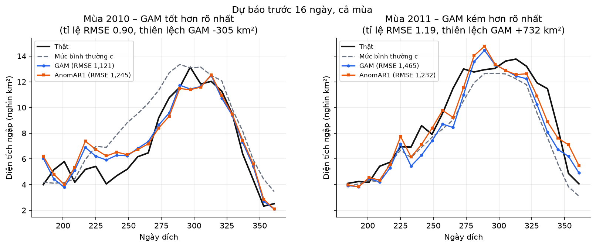

*Hình 11. Dự báo trước 16 ngày cho cả mùa.*

- **2010** (GAM tốt hơn, tỉ lệ 0,90): mức bình thường (xám đứt) cao hơn thực tế suốt giai đoạn nước lên. Cả hai mô hình đều kéo xuống, GAM kéo nhiều hơn nhờ đường sửa lệch, nên sát thực tế hơn.
- **2011** (GAM kém hơn, tỉ lệ 1,19): năm lũ lớn và kéo dài. Thực tế **cao hơn** mức bình thường ở đỉnh và khi nước rút. GAM vẫn kéo dự báo xuống theo thói quen học từ các năm trước, nên hụt nhiều hơn (thiên lệch +732 km² so với +247 của AnomAR1).
- **Bài học:** sửa lệch bằng một đường cố định chỉ đúng khi xu hướng tiếp diễn. Năm nào lũ bật ngược xu hướng thì phần sửa này làm dự báo tệ hơn.

### B5.5 Phần phụ: bóc tách GAM

> Thí nghiệm này được nghĩ ra **sau khi đã xem kết quả test**, chỉ để hiểu phần nào của GAM tạo ra
> kết quả. Không dùng để thay GAM trong bảng so sánh của nhóm. Muốn dùng biến thể nào thì phải khai
> báo trước, ghi `docs/decisions.md` và chạy lại cho mọi mô hình.

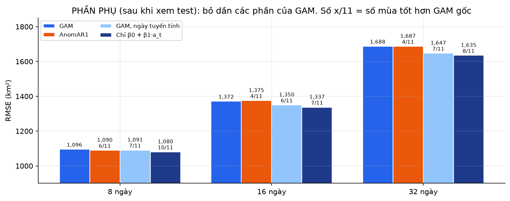

*Hình 12. Nguồn: `gam_ablation_rmse.csv`. Số x/11 là số mùa biến thể tốt hơn GAM gốc.*

| RMSE (km²) | 8 ngày | 16 ngày | 32 ngày |
|---|---|---|---|
| GAM gốc | 1.096 | 1.372 | 1.688 |
| Thay s(ngày) bằng đường thẳng | 1.091 (7/11) | 1.350 (6/11) | 1.647 (7/11) |
| Chỉ β0 + β1·a_t (bỏ ngày và a_{t−1}) | 1.080 (10/11) | 1.337 (7/11) | 1.635 (8/11) |

- Bỏ dần các phần của GAM **không làm tệ đi**; mô hình đơn giản nhất lại nhỉnh hơn 1–3%.
- Gợi ý: cái có ích là **hệ số chặn** (sửa lệch bằng một hằng số, ít phương sai). Đường cong theo ngày và trễ thứ hai thêm phương sai nhiều hơn thêm tín hiệu.
- Chênh lệch nhỏ so với nhiễu của 11 mùa, và chưa kiểm định ý nghĩa. Đây là giả thuyết cho việc sau, không phải kết luận.

---

## B6. Điểm mạnh, điểm yếu, hạn chế và cách nói an toàn

**Điểm mạnh**
- Dễ diễn giải: mỗi thành phần vẽ được (Hình 3, 5, 6).
- Ổn định khi ít dữ liệu: bản 7 mùa gần như không đổi.
- Không phụ thuộc số ngẫu nhiên; kết quả ít nhạy với lưới cấu hình.
- Tự phát hiện điểm yếu của baseline: mức bình thường 5 mùa bị lệch cao.

**Điểm yếu**
- Không vượt AnomAR1 ở tầm nào. Phần phi tuyến không đem lại lợi ích đo được.
- Đường sửa lệch học từ quá khứ: gãy khi một năm lũ lớn đi ngược xu hướng (2011, 2017).
- Kém hơn một chút ở đỉnh lũ và khi nước rút.

**Hạn chế**
- 11 mùa test, một chuỗi toàn vùng, khoảng tin cậy rộng.
- p TOST chưa hiệu chỉnh đa kiểm định.
- Khoảng tin cậy của hàm trơn trong pyGAM thường hẹp hơn thực tế, nên không dùng p-value của pyGAM để kết luận.
- Phần bóc tách làm sau khi xem test.

**Cách nói an toàn**
- Nên nói: "GAM tương đương AnomAR1 ở tầm 8 ngày trong biên ±5% RMSE"; "ở 16 và 32 ngày chưa phân biệt được".
- Không nói: "GAM tốt hơn" hay "GAM bằng AnomAR1" ở 16–32 ngày.
- Nên nói: "đường sửa lệch **phù hợp với** xu hướng đỉnh lũ giảm".
- Không nói: "do đê bao / đập thượng nguồn".

---

## B7. Câu hỏi vấn đáp tự chuẩn bị

1. **GAM khác hồi quy tuyến tính ở đâu?** Thay một hệ số bằng một hàm trơn học từ dữ liệu, có phạt độ cong để tránh khớp quá. Ở đây chỉ biến ngày dùng hàm trơn; hai trễ vẫn tuyến tính.
2. **Vì sao dự báo anomaly mà không dự báo thẳng diện tích?** Phần lớn biến động là chu kỳ mùa, mà mức bình thường đã chứa chu kỳ đó. Mô hình chỉ còn học phần lệch: nhỏ hơn, gần dừng hơn, và so sánh được trực tiếp với AnomAR1.
3. **GAM là thống kê hay ML?** Là mô hình thống kê. Nó có giả định, hệ số diễn giải được, và độ linh hoạt bị kiểm soát bằng phạt. Thực tế ở đây nó hành xử như hồi quy tuyến tính (β1 ≈ φ^h, đường cong có 2–6 bậc tự do).
4. **Cấu hình được chọn thế nào, có nhìn mùa test không?** Không. Mỗi fold dành 3 mùa cuối của tập học làm validation, chọn cấu hình MSE nhỏ nhất rồi học lại trên toàn tập học. Test `test_tuning_never_sees_test_rows` kiểm tra điều này.
5. **Vì sao GAM gần như trùng AnomAR1?** Cả hai cùng dự báo anomaly từ anomaly hôm nay. β1 của GAM gần φ^h và β2 gần 0. Khác biệt duy nhất đáng kể là đường sửa lệch theo ngày.
6. **"Tương đương" ở 8 ngày có nghĩa là gì?** TOST bác bỏ giả thuyết "chênh lệch RMSE lớn hơn 5%" (p = 0,002). Khác với "không khác biệt có ý nghĩa": ở 16–32 ngày cũng không khác biệt, nhưng khoảng tin cậy quá rộng để nói tương đương.
7. **Phần dư tự tương quan có vi phạm giả định không?** Với dự báo trực tiếp h bước, tự tương quan đến độ trễ h−1 là tất yếu, và mức quan sát khớp lý thuyết AR(1). Nó chỉ ảnh hưởng sai số chuẩn khi coi từng bước là độc lập, nên nhóm kiểm định ở cấp mùa.
8. **Vì sao GAM kém ở mùa 2011?** Đường sửa lệch học rằng mức bình thường thường cao hơn thực tế, nhưng 2011 là năm lũ lớn và kéo dài, đi ngược xu hướng. GAM vì vậy dự báo thấp (thiên lệch +732 km²).
9. **Nếu chỉ được chọn một cải tiến, đó là gì?** Thêm hệ số chặn vào AnomAR1, hoặc dùng mức bình thường có xu hướng. Phân tích bóc tách gợi ý điều này nhưng làm sau khi xem test, nên phải khai báo trước và chạy lại cho cả nhóm mới dùng được.

---

## Danh mục bảng (src/GAM/result/tables/)

| File | Nội dung |
|---|---|
| `gam_predictions.csv` | Mọi dự báo: gam, gam_w7, anom_ar1 (cùng fold) |
| `gam_chosen_configs.csv` | Cấu hình được chọn và MSE validation của 6 cấu hình |
| `gam_coefficients.csv` | β0, β1, β2, bậc tự do, pseudo R² theo fold và tầm |
| `gam_seasonal_curve.csv` | Đường β0 + s(ngày) theo fold và tầm |
| `reproduction_check.csv` | Độ lệch so với dự báo chung của nhóm |
| `gam_rmse.csv` | RMSE gộp, kèm mô hình tham chiếu |
| `gam_vs_anom_ar1.csv` | Kiểm định cấp mùa (t, Wilcoxon, TOST, Holm) |
| `gam_season_rmse.csv` | RMSE và thiên lệch từng mùa |
| `gam_by_phase.csv`, `gam_by_magnitude.csv` | Theo giai đoạn lũ, theo cỡ lũ |
| `gam_residual_tests.csv`, `gam_residual_summary.csv` | Chẩn đoán phần dư |
| `climatology_bias.csv` | Anomaly TB theo ngày và xu hướng đỉnh lũ |
| `gam_ablation_predictions.csv`, `gam_ablation_rmse.csv` | Phần phụ: bóc tách |
